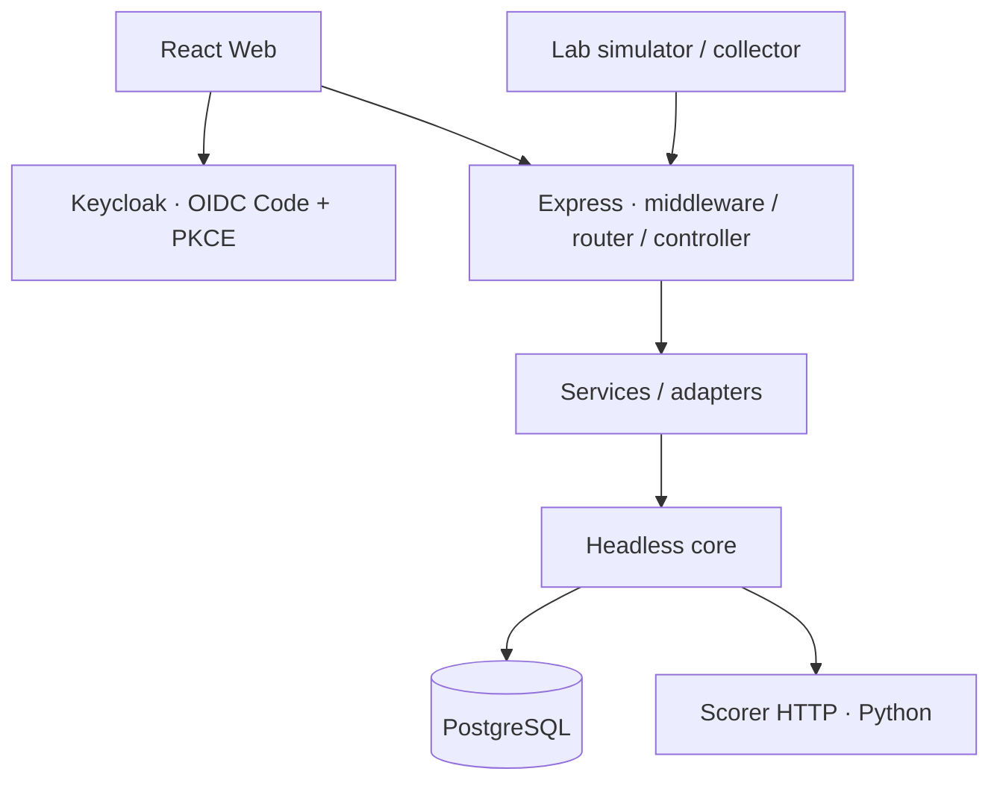

# Kiến trúc TraceWeaver

TraceWeaver điều tra hành trình cấp môi trường thực hành từ dấu vết intake, account và provision.
Tài liệu mô tả ranh giới source; trạng thái triển khai theo từng phiên bản nằm ở [CURRENT_STATUS](docs/overview/status.md).

## Ba tầng

| Tầng | Trách nhiệm | Source |
|---|---|---|
| Open-Core headless | Identity, quyền dữ liệu, transaction, reconstruction, workflow và audit | `backend/src/core/` |
| H-P-D-I | Human: workspace/vai trò/tri thức; Process: review/hồ sơ; Data: events/provenance/dashboard; Intelligence: luật/scorer/bằng chứng | Core cùng lớp service và adapter của backend |
| Ứng dụng | Điều tra yêu cầu lab, sandbox và giao diện vận hành | `frontend/`, API nghiệp vụ, `simulator/` |

Core không phụ thuộc React hoặc Express. Hợp đồng HTTP nằm ở [OpenAPI và JSON Schema](backend/contracts/README.md).
Xem [core README](backend/src/core/README.md) để theo dõi ranh giới module và các thay đổi refactor hiện tại.

Entry point headless là `backend/src/core/index.js`. Workflow repository/store dùng chung nằm trong
`core/workflow/`; ứng dụng đăng ký definition và chính sách tạo ở phía server.
`backend/src/adapters/case-workflow.js` nối nghiệp vụ case vào repository này, giữ quyền nguồn,
run lock, evidence và audit. Các entry point cũ trong `core/data/` giữ tương thích cho API hiện có.
Quyền workspace dùng chung nằm ở `core/identity/workspace-access.js`; scope của run nằm riêng
ở `core/reconstruction/run-scope.js`. Refactor không đổi endpoint, cấu hình hay schema DB.

## Luồng dữ liệu

1. Collector gửi EventInput qua ingestion với danh tính dịch vụ và quyền nguồn.
2. Backend xác thực, kiểm giới hạn, redaction và chống trùng; lưu provenance trong PostgreSQL.
3. Người vận hành chọn phạm vi nguồn/thời gian và tạo run. Backend kiểm quyền hiện tại và cố định snapshot.
4. Engine áp dụng guard về ID, thứ tự, kết quả và ambiguity. Scorer chỉ nhận các cặp hợp lệ đã lọc quyền.
5. Người review duyệt hoặc bổ sung liên kết. Version và audit giữ lịch sử quyết định.
6. Hồ sơ gắn run/bằng chứng và đi qua workflow có guard. Hồ sơ sandbox yêu cầu kiểm chứng nguồn phù hợp trước khi đóng.

Tái dựng chỉ phân tích dấu vết đã có. Chạy lại sandbox thực thi mô phỏng nghiệp vụ, sinh log và bằng chứng mới.
Hai thao tác có trạng thái và mục đích riêng; xem [simulator](simulator/README.md) và [sandbox](backend/LAB_SANDBOX.md).

## Ranh giới tin cậy

- Keycloak xác thực người dùng; quyền workspace và nguồn do backend kiểm từ DB, kể cả khi đọc artifact cũ.
- Core HTTP dùng danh tính ứng dụng riêng, đồng thời kiểm JWT người dùng độc lập; xem [WORKFLOW](backend/WORKFLOW.md).
- Scorer không có quyền ghi DB/workflow. Model opt-in không tự duyệt liên kết hoặc phá ambiguity; lỗi scorer có fallback.
- Business write và audit cần chung transaction. Events, snapshots và bằng chứng lịch sử được giữ để đối chiếu.
- Oracle đáp án của dataset chỉ dành cho đánh giá; không đưa vào runtime hoặc feature.
- Secret, credentials, cache và báo cáo vận hành riêng nằm ngoài Git.

## Triển khai và mở rộng

[compose.dev.yaml](compose.dev.yaml) chạy PostgreSQL cho development.
[compose.yaml](compose.yaml) cấu hình backend/Identity và các dịch vụ đi kèm; hướng dẫn ở [Docker](backend/DOCKER.md).
Web và Python có hướng dẫn chạy riêng, không có cam kết dựng toàn bộ ứng dụng bằng một lệnh.
Triển khai Oracle được mô tả tại [deploy/oracle](deploy/oracle/README.md).

Nghiệp vụ mới nên tái sử dụng Identity/Data/Workflow, định nghĩa guard và adapter riêng, đồng thời giữ contract, quyền và audit.
Chất lượng model trên dữ liệu đại diện, full browser E2E, tải và backup/restore cần bằng chứng kiểm riêng; xem [TESTING](TESTING.md).
