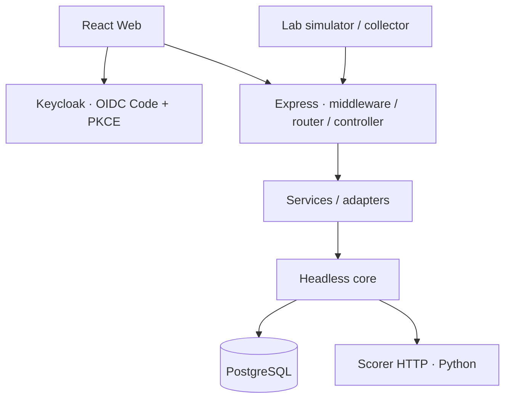

# Kiến trúc TraceWeaver

TraceWeaver điều tra hành trình cấp môi trường thực hành từ log của ba bước: tiếp nhận yêu cầu (intake), tạo tài khoản (account) và cấp môi trường (provision).
Tài liệu mô tả cách chia trách nhiệm trong mã nguồn; trạng thái triển khai theo từng phiên bản nằm ở [CURRENT_STATUS](docs/overview/status.md).

## Ba tầng

| Tầng | Trách nhiệm | Source |
|---|---|---|
| Lõi dùng chung, không có giao diện riêng | Đăng nhập, quyền dữ liệu, lưu thay đổi đồng thời (transaction), dựng hành trình, quy trình hồ sơ và lịch sử thao tác | `backend/src/core/` |
| H-P-D-I | Human: thành viên, vai trò và tri thức; Process: duyệt liên kết và hồ sơ; Data: bản ghi, nguồn gốc và thống kê; Intelligence: quy tắc, điểm AI và bằng chứng | Lõi xử lý, các dịch vụ nghiệp vụ và lớp kết nối trên máy chủ |
| Ứng dụng | Điều tra yêu cầu cấp máy thực hành, môi trường mô phỏng và giao diện vận hành | `frontend/`, API nghiệp vụ, `simulator/` |

Core không phụ thuộc React hoặc Express. Quy định dữ liệu gửi/nhận qua HTTP nằm ở [OpenAPI và JSON Schema](backend/contracts/README.md).
Xem [core README](backend/src/core/README.md) để theo dõi ranh giới module và các thay đổi tổ chức lại mã nguồn hiện tại.

Ứng dụng dùng lõi xử lý trực tiếp qua `backend/src/core/index.js`. Phần đọc/ghi dữ liệu quy trình dùng chung nằm trong
`core/workflow/`; ứng dụng đăng ký định nghĩa quy trình và chính sách tạo ở phía máy chủ.
`backend/src/adapters/case-workflow.js` nối nghiệp vụ hồ sơ vào repository này, giữ kiểm quyền nguồn,
khóa lần dựng hành trình khi cập nhật, bằng chứng và lịch sử thao tác. Các điểm gọi cũ trong `core/data/` giữ tương thích cho API hiện có.
Quyền nhóm làm việc dùng chung nằm ở `core/identity/workspace-access.js`; phạm vi dữ liệu của lần dựng hành trình nằm riêng
ở `core/reconstruction/run-scope.js`. Việc tổ chức lại mã nguồn không đổi địa chỉ API, cấu hình hoặc cấu trúc cơ sở dữ liệu.

## Luồng dữ liệu

1. Bộ thu thập gửi bản ghi theo cấu trúc EventInput tới API nhận log, dùng tài khoản dịch vụ có quyền trên nguồn đó.
2. Máy chủ kiểm tài khoản, giới hạn dữ liệu, che thông tin bí mật và chống trùng; lưu cả thông tin nguồn gốc bản ghi vào PostgreSQL.
3. Người vận hành chọn phạm vi nguồn/thời gian và tạo lần dựng hành trình. Máy chủ kiểm quyền hiện tại và lưu cố định bộ log dùng cho lần dựng này.
4. Bộ dựng hành trình kiểm mã liên kết, thứ tự, kết quả và các nhánh còn mơ hồ. Dịch vụ AI chỉ chấm các cặp thỏa điều kiện và thuộc nguồn người dùng được đọc.
5. Người kiểm duyệt duyệt hoặc bổ sung liên kết. Số phiên bản giúp tránh ghi đè quyết định mới; lịch sử ghi lại từng thay đổi.
6. Hồ sơ gắn với hành trình và bằng chứng, chuyển qua các bước có điều kiện kiểm tra. Hồ sơ mô phỏng cần kết quả kiểm chứng nguồn phù hợp trước khi đóng.

Tái dựng chỉ phân tích dấu vết đã có. Chạy lại trong môi trường mô phỏng thực thi nghiệp vụ, sinh log và bằng chứng mới.
Hai thao tác có trạng thái và mục đích riêng; xem [simulator](simulator/README.md) và [sandbox](backend/LAB_SANDBOX.md).

## Ranh giới tin cậy

- Keycloak xác thực người dùng; máy chủ kiểm quyền nhóm làm việc và nguồn từ cơ sở dữ liệu, kể cả khi đọc kết quả cũ.
- Core HTTP dùng danh tính ứng dụng riêng, đồng thời kiểm riêng mã truy cập có chữ ký (JWT) của người dùng; xem [WORKFLOW](backend/WORKFLOW.md).
- Dịch vụ AI không được ghi cơ sở dữ liệu hoặc chuyển bước hồ sơ. Mô hình chỉ dùng khi được bật cấu hình, không tự duyệt liên kết hay chọn thay người dùng khi còn mơ hồ. Khi AI lỗi, hệ thống dùng quy tắc.
- Thay đổi nghiệp vụ và lịch sử thao tác phải cùng được lưu thành công hoặc cùng hủy trong một giao dịch dữ liệu. Bản ghi, bộ dữ liệu của lần dựng và bằng chứng cũ được giữ để đối chiếu.
- Đáp án của bộ dữ liệu (oracle) chỉ phục vụ đánh giá; không đưa vào chương trình đang chạy hoặc đặc trưng đầu vào của AI.
- Khóa bí mật, thông tin đăng nhập, bộ nhớ đệm và báo cáo vận hành riêng nằm ngoài Git.

## Triển khai và mở rộng

[compose.dev.yaml](compose.dev.yaml) chạy PostgreSQL khi phát triển trên máy cá nhân.
[compose.yaml](compose.yaml) cấu hình máy chủ và đăng nhập và các dịch vụ đi kèm; hướng dẫn ở [Docker](backend/DOCKER.md).
Web và Python có hướng dẫn chạy riêng, không có cam kết dựng toàn bộ ứng dụng bằng một lệnh.
Triển khai Oracle được mô tả tại [deploy/oracle](deploy/oracle/README.md).

Nghiệp vụ mới nên tái sử dụng đăng nhập, dữ liệu và quy trình dùng chung, bổ sung điều kiện kiểm tra và lớp kết nối riêng; vẫn giữ đúng quy định API, quyền và lịch sử thao tác.
Chất lượng mô hình trên dữ liệu đại diện, toàn bộ hành trình người dùng trên trình duyệt, khả năng chịu tải và sao lưu/khôi phục cần bằng chứng kiểm riêng; xem [TESTING](TESTING.md).
