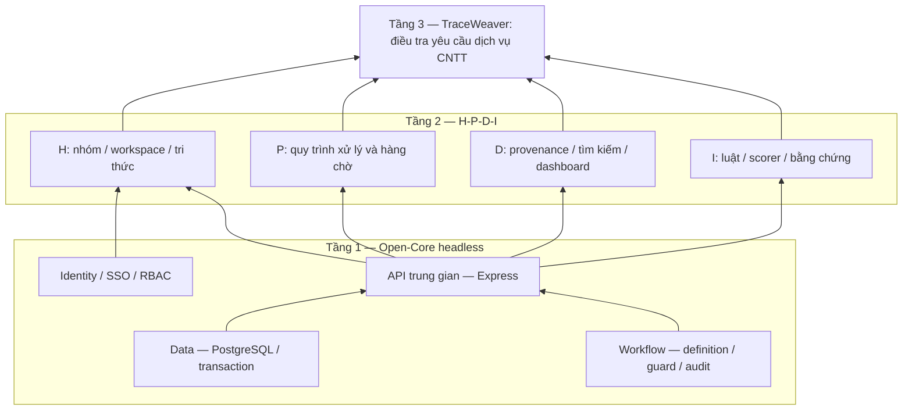

# TraceWeaver

Base dự án tái dựng hành trình yêu cầu cấp môi trường thực hành từ dấu vết của ba dịch vụ intake, account và provision, định hướng DX-Lab HaUI 2026.

## Cấu trúc

```text
backend/
  src/           # Express, services và headless core
  scripts/       # Thiết lập môi trường và migration
  tests/         # Backend, contract và DB integration
  contracts/     # OpenAPI, JSON Schema và fixtures
  package.json
frontend/        # Khung giao diện
ai/              # Khung scorer và training
simulator/       # Khung sinh dữ liệu giả
.github/         # Issue/PR templates và CI
```

Backend dùng JavaScript ES modules, Express và PostgreSQL. Đã có foundation, Keycloak local/Swagger PKCE login, JWT/JWKS, batch ingestion và GET /me, sources, knowledge, events, event detail với quyền từ DB. Workflow và AI vẫn thuộc bước sau; OpenAPI phân biệt 6 implemented/15 planned. Phạm vi triển khai hiện tại là BE.

Chạy API bằng Docker sau bước [chuẩn bị Keycloak/demo](backend/KEYCLOAK.md): `docker compose up -d --build --wait api`. Mặc định API tại `http://localhost:8080`; đăng nhập Swagger bằng **Authorize → keycloakLogin**. Máy hiện tại đã chuẩn bị xong; mật khẩu nằm trong `demo-credentials.local.json` bị Git ignore. Chi tiết tại [Docker API](backend/DOCKER.md).

## Chạy backend

Yêu cầu Node.js 24.14.1, npm 11.11.0 và PostgreSQL 17 hoặc Docker Compose.

```sh
npm ci
npm run db:setup
# Chỉ cần pull khi máy chưa có image PostgreSQL:
docker compose -f compose.dev.yaml pull postgres
npm run db:up
npm run db:migrate
npm run dev:be
```

Nếu đã có `.env`, bỏ qua `db:setup`; bổ sung CURSOR_SECRET ngẫu nhiên ≥32 ký tự nếu thiếu và giữ DB credentials. Xem [cấu hình Identity phía BE](backend/IDENTITY.md). Có thể dùng PostgreSQL riêng bằng DATABASE_URL.

- `GET http://127.0.0.1:8080/health/live`: tiến trình hoạt động.
- `GET http://127.0.0.1:8080/health/ready`: DB và migrations sẵn sàng.
- `npm test`: unit, HTTP và contract tests, không cần DB.
- `npm run test:db`: integration, cần PostgreSQL và quyền tạo DB test.
- `npm run test:identity`: JWT/quyền nguồn qua PostgreSQL và Postman CLI >=1.74.0, không chạy FE/AI.
- `npm run start:be`: chạy backend không watch.
- `npm run db:stop`: dừng DB và giữ dữ liệu.

PowerShell có thể dùng `npm.cmd`. Makefile cung cấp lệnh tương đương cho môi trường có GNU Make.

## Ranh giới kiến trúc

Core cung cấp Identity/Data/Workflow dùng chung, không phụ thuộc UI. Backend là lớp HTTP trung gian. Các module sau sẽ bổ sung workspace/tri thức, dữ liệu có provenance, review và workflow có audit, cùng scorer có bằng chứng và giới hạn rõ ràng. Base hiện tại chưa phải sản phẩm hoàn chỉnh hoặc bằng chứng đạt nghiệm thu bài thi.

Xem [cài đặt](INSTALL.md), [đóng góp](CONTRIBUTING.md), [bảo mật](SECURITY.md) và [API contracts](backend/contracts/README.md).

Mã nguồn dự án dùng [Apache-2.0](LICENSE). Dependency giữ giấy phép riêng; xem [bảng dependency/license](backend/DEPENDENCIES.md) và [thông báo bên thứ ba](backend/THIRD_PARTY_NOTICES.txt).

## Kiến trúc DX-OS ba tầng



Sơ đồ mô tả ranh giới kiến trúc mục tiêu. Luồng gọi khi triển khai: giao diện → API → Identity kiểm quyền → service nghiệp vụ → core Data/Workflow; scorer chỉ nhận dữ liệu đã được lọc quyền. Core không import Express hoặc giao diện và phải có thể tái sử dụng cho nghiệp vụ khác.

| Thành phần | Hiện trạng bộ khung | Phần cần triển khai tiếp |
|---|---|---|
| API trung gian | Express, health, giới hạn body, lỗi/request ID | Endpoint nghiệp vụ có xác thực |
| Data | PostgreSQL, transaction, migrations nền | Repository và service nghiệp vụ |
| Identity | JWT/JWKS user/ingest client, membership/role/group/source grants cho sáu API | IdP thật, login/SSO và quyền cho các API còn lại |
| Workflow | Khung module và API contract | Engine dùng chung, guard và audit |
| H-P-D-I / ứng dụng | Khung frontend và contract | Workspace/tri thức, hồ sơ, tìm kiếm/dashboard |
| Intelligence | Khung scorer/training và contract | Luật/scorer, giải thích, đánh giá và fallback |
| Dữ liệu demo | Fixtures kiểm schema synthetic | Dataset có provenance/manifest và kịch bản đầu-cuối |

## API và tài khoản demo

Health API tại [health.openapi.json](backend/contracts/health.openapi.json). [openapi.json](backend/contracts/openapi.json) đánh dấu 6 operation implemented: GET /me, sources, knowledge, events, event detail và POST batch ingestion; còn 15 planned. Đã kiểm Authorization Code/PKCE, refresh, token user/service và quyền API với Keycloak local/PostgreSQL thật; Postman JWKS vẫn dùng cho hồi quy lỗi IdP. Chưa nghiệm thu triển khai production.

Base chưa có đăng nhập nên chưa có tài khoản demo. Khi triển khai Identity, tài khoản và mật khẩu demo phải được tạo tại máy qua seed, không lưu mật khẩu/token thật trong repository.

## Kiểm chứng và phát triển

```sh
npm run check:base
npm run licenses:check
npm test
# Sau khi DB đã khởi động và migrate:
npm run smoke
npm run test:db
```

CI kiểm bộ khung và tests trên Linux/Windows; job PostgreSQL kiểm migration, integration và health readiness thật. `npm run licenses` cập nhật bảng dependency và nguyên văn license từ các package đã cài; `licenses:check` phát hiện dữ liệu bị lệch lockfile.

[Issue tracker](https://github.com/HaUI-HIT-Tam-Thai-T/TraceWeaver/issues) tiếp nhận bug/feature. Bản `v0.1.0-base.1` đánh dấu bộ khung, không phải bản nghiệm thu sản phẩm. Yêu cầu chức năng của bài thi cần tiếp tục có code chạy, dữ liệu demo và bằng chứng kiểm thử thực tế.
