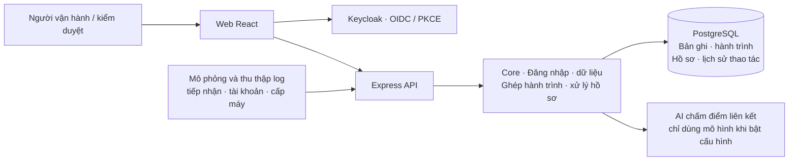

# TraceWeaver (Bài dự thi Phần Mềm Nguồn Mở 2026)

<p align="center">
  
</p>

<p align="center"><strong>Từ log rời rạc đến hành trình yêu cầu có bằng chứng.</strong></p>

<p align="center">
  <a href="./LICENSE"></a>
  <a href="https://github.com/HaUI-HIT-Tam-Thai-T/TraceWeaver/actions/workflows/ci.yml"></a>
  
</p>

<div align="center">

[Mở TraceWeaver](https://traceweaver.quizlearn.tech) &nbsp; · &nbsp; [Hướng dẫn demo](docs/guides/demo.md) &nbsp; · &nbsp; [Cài đặt](./INSTALL.md) &nbsp; · &nbsp; [API](https://api.quizlearn.tech/docs/) &nbsp; · &nbsp; [Tài liệu](./docs/README.md)

**Tiếng Việt** · [English](./README_EN.md)

</div>

**Đội:** HaUI.HIT-Tam-Thái-Tử

**Trường:** Trường Công nghệ Thông tin và Truyền thông, Đại học Công nghiệp Hà Nội

**Trải nghiệm trực tuyến:** [traceweaver.quizlearn.tech](https://traceweaver.quizlearn.tech) · **Tài liệu:** [Hướng dẫn và thiết kế hệ thống](./docs/README.md)

**Dự thi OLP Phần mềm nguồn mở 2026.** TraceWeaver giúp người vận hành tìm nguyên nhân một yêu cầu bị lỗi, theo dõi việc xử lý và kiểm tra lại sau khi sửa. Dự án minh họa bằng quy trình tiếp nhận yêu cầu, tạo tài khoản và cấp môi trường thực hành CNTT.

---

## 💡 Giới thiệu

Khi một yêu cầu đi qua nhiều dịch vụ, mỗi dịch vụ ghi một phần nhật ký hoạt động (log). Nếu cấp môi trường thất bại, người vận hành thường phải tìm từng bản ghi để biết yêu cầu đã qua bước nào và lỗi ở đâu.

TraceWeaver ghép các bản ghi liên quan thành một hành trình để bạn xem lại toàn bộ quá trình. Ví dụ: yêu cầu đã được tiếp nhận, tài khoản đã tạo thành công, nhưng bước cấp máy thất bại vì thiếu RAM.

Bạn có thể mở hồ sơ cho sự cố đó, giao người xử lý, ghi lại bằng chứng và kiểm tra kết quả sau khi sửa. Dự án có môi trường mô phỏng (sandbox) để thử các lỗi về RAM, bản cài hệ điều hành và tài khoản mà không cấp tài nguyên thật.

Nếu muốn dùng thử, mở [bản web trực tuyến](https://traceweaver.quizlearn.tech) và chọn [tài khoản demo](#chọn-vai-trò-để-trải-nghiệm). Bạn không cần cài công cụ lập trình trên máy.

## ✨ Điểm nổi bật

- Xem các bước của cùng một yêu cầu trên một hành trình, thay vì dò từng nguồn log riêng.
- Mỗi kết quả đều giữ bản ghi gốc, nguồn phát sinh và lịch sử người đã xem xét hoặc sửa quyết định.
- Khi thiếu dữ liệu hoặc có nhiều cách ghép hợp lý, hệ thống đánh dấu chưa xác định để người dùng kiểm tra tiếp.
- AI hỗ trợ chấm điểm các cặp bản ghi có thể liên quan. Người kiểm duyệt quyết định có chấp nhận liên kết hay không; nếu AI không hoạt động, hệ thống vẫn dùng các quy tắc đã định sẵn.
- Trong môi trường mô phỏng, việc sửa điều kiện và việc chạy lại yêu cầu là hai bước riêng. Hồ sơ chỉ được đóng khi bước kiểm chứng của hệ thống xác nhận đủ bằng chứng.
- Người dùng chỉ đọc và thao tác được trong nhóm làm việc, vai trò và nguồn dữ liệu đã được cấp quyền.

## 🖥️ Giao diện

Giao diện web chia dữ liệu theo nhóm làm việc (workspace). Bạn đăng nhập qua Keycloak, dịch vụ quản lý tài khoản của hệ thống; máy chủ kiểm tra bạn được xem và làm những gì.

| Màn hình | Đường dẫn | Nội dung |
|---|---|---|
| Tổng quan | `/dashboard` | Thống kê và điều hướng tới hồ sơ trong phạm vi được phép |
| Sự kiện | `/events`, `/events/:eventId` | Tìm bản ghi, xem nguồn phát sinh và dựng lại hành trình yêu cầu |
| Hồ sơ | `/cases`, `/cases/:caseId` | Theo dõi xử lý, xem hành trình, duyệt liên kết và thử lại trong môi trường mô phỏng |
| Tri thức | `/knowledge` | Tra cứu tri thức theo nhóm làm việc |
| Quản trị workspace | `/workspace-admin` | Thành viên, vai trò, quyền nguồn và cấp tài khoản theo cấu hình |

Hướng dẫn phiên đăng nhập và API client ở [frontend/README.md](./frontend/README.md).
Kịch bản thao tác cùng kết quả cần quan sát ở [docs/guides/demo.md](docs/guides/demo.md).

## 🗺️ Kiến trúc tổng thể



Trình duyệt gửi yêu cầu tới máy chủ qua API, tức các địa chỉ nhận và trả dữ liệu cho ứng dụng. Máy chủ kiểm tra quyền, xử lý yêu cầu và lưu kết quả trong cơ sở dữ liệu PostgreSQL.
Bộ phận AI chỉ chấm điểm các cặp bản ghi đã được phép đọc. AI không tự ghi dữ liệu hoặc chuyển trạng thái hồ sơ.
Vai trò module và luồng dữ liệu ở [ARCHITECTURE.md](./ARCHITECTURE.md).

## 🧱 Kiến trúc 3 tầng


Ba tầng dưới đây đi từ phần xử lý dùng chung đến ứng dụng người dùng thao tác. Các mũi tên trong hình thể hiện mối quan hệ giữa các tầng.

| Tầng | Thành phần và công việc |
|---|---|
| **1. Open-Core: lõi xử lý dùng chung** | Không có màn hình riêng. Lõi quản lý đăng nhập và quyền truy cập (Identity), lưu dữ liệu (Data), ghép hành trình (Reconstruction), xử lý các bước của hồ sơ (Workflow) và ghi lịch sử thao tác (audit). |
| **2. H-P-D-I: tổ chức chức năng vận hành** | Chia các chức năng thành bốn nhóm: con người (Human), quy trình (Process), dữ liệu (Data) và hỗ trợ phân tích (Intelligence). |
| **3. Ứng dụng TraceWeaver** | Giao diện điều tra sự cố, các chức năng xử lý hồ sơ trên máy chủ và môi trường mô phỏng cấp máy thực hành. |

| Nhóm chức năng | Điều tra và xử lý hồ sơ | Mô phỏng và kiểm chứng |
|---|---|---|
| **H: Con người** | Quản lý nhóm làm việc, thành viên, vai trò và quyền đọc từng nguồn log. | Người vận hành điều tra; quản trị viên sửa điều kiện; người kiểm duyệt xác minh kết quả. |
| **P: Quy trình** | Dựng hành trình, duyệt liên kết, phân công, thêm bằng chứng và chuyển trạng thái theo điều kiện đã đặt. | Sửa điều kiện, chạy lại yêu cầu, chuyển log mới vào hệ thống, kiểm tra bằng chứng rồi đóng hồ sơ khi đủ điều kiện. |
| **D: Dữ liệu** | Lưu bản ghi cùng nguồn gốc, dữ liệu của mỗi lần dựng hành trình, lịch sử xử lý và số liệu tổng hợp. | Lưu trạng thái RAM, bản cài hệ điều hành, tài khoản, từng lần chạy và kết quả kiểm chứng. |
| **I: Hỗ trợ phân tích** | Dùng quy tắc và điểm AI để gợi ý bản ghi liên quan; để người kiểm tra tiếp nếu chưa đủ dữ kiện. | Đối chiếu kết quả chạy với điều kiện hiện tại. Điểm AI không thay thế bằng chứng yêu cầu đã chạy đạt. |

Xem [kiến trúc chi tiết](./ARCHITECTURE.md) và [ranh giới core](./backend/src/core/README.md).

## 🧩 Tính năng

| Bạn cần làm gì? | TraceWeaver hỗ trợ |
|---|---|
| Tìm yêu cầu bị lỗi | Tìm và lọc log theo nguồn, thời gian; xem nội dung và nơi phát sinh bản ghi. |
| Hiểu yêu cầu đã đi qua đâu | Dựng hành trình từ các bản ghi liên quan, xem từng liên kết và dữ liệu làm căn cứ. Mỗi lần dựng lưu lại bộ dữ liệu đã dùng để đối chiếu về sau. |
| Xử lý sự cố | Tạo hồ sơ, phân công, thêm bằng chứng, duyệt hoặc sửa liên kết và theo dõi lịch sử. |
| Kiểm tra việc sửa lỗi | Trong môi trường mô phỏng, sửa điều kiện gây lỗi, chạy lại yêu cầu và lấy kết quả kiểm chứng mới. |
| Quản lý truy cập | Thêm thành viên, giao vai trò và cấp hoặc thu hồi quyền đọc nguồn dữ liệu. |

[Bảng tính năng và kiểm thử](docs/overview/features.md) cho biết mỗi chức năng được kiểm tra ở đâu. [Tình trạng triển khai](docs/overview/status.md) ghi phiên bản đang chạy.
Mô hình AI hiện được thử trên dữ liệu tự sinh, chưa chứng minh đạt mục tiêu chất lượng trên dữ liệu thực tế đại diện; xem [kết quả và giới hạn mô hình](./ai/artifacts/sandbox-v2/README.md).

## 🧰 Công nghệ và giấy phép

| Thành phần | Công nghệ | Giấy phép / tài liệu kiểm kê |
|---|---|---|
| Máy chủ | Node.js 24, JavaScript ES modules, Express, JOSE | Mã dự án Apache-2.0; [npm inventory](./backend/DEPENDENCIES.md) |
| Giao diện web | React, TypeScript, Vite, Tailwind, MUI, Radix UI | Mã dự án Apache-2.0; [frontend inventory](./frontend/DEPENDENCIES.md) |
| Dịch vụ AI | Python, FastAPI, Pydantic, model JSON | Mã dự án Apache-2.0; thư viện MIT, BSD, Apache-2.0, PSF; [Python inventory](./ai/DEPENDENCIES.md) |
| Đăng nhập tập trung | Keycloak | Apache-2.0; phiên bản/digest ở [runtime inventory](./backend/DEPENDENCIES.md#runtime-and-services) |
| Dữ liệu | PostgreSQL 17 | PostgreSQL License |
| Bộ mô phỏng | Node.js, sinh dữ liệu giả với giá trị khởi tạo để có thể tạo lại cùng bộ dữ liệu | Mã dự án Apache-2.0; [simulator](./simulator/README.md) |

Mã nguồn dự án theo [Apache-2.0](./LICENSE). Thư viện và tài sản do bên thứ ba cung cấp giữ giấy phép riêng.
Danh sách thư viện, thông báo bản quyền và phạm vi phân phối ở [LICENSES.md](./LICENSES.md); danh mục thành phần phần mềm để công cụ tự đọc (SBOM, định dạng CycloneDX) ở [sbom/](./sbom/README.md).

## 🚀 Cài đặt và chạy

### 💻 Yêu cầu hệ thống

<details>
<summary>Yêu cầu công cụ và cổng kết nối</summary>

| Hạng mục | Yêu cầu | Ghi chú |
|---|---|---|
| Source | Git | Clone repository |
| Backend / simulator | Node.js 24.14.1, npm 11.11.0 | Phiên bản theo cấu hình dự án |
| Database | PostgreSQL 17 | Có thể dùng Docker Compose v2 hoặc DB riêng |
| Web | Node/npm và trình duyệt | Cài dependencies riêng tại `frontend/` |
| AI tùy chọn | Python và venv theo [AI RUN](./ai/RUN.md) | Cài đúng pinned requirements |
| Cổng local | API 8080, PostgreSQL 55432, Keycloak 8081, web 5173 | Có thể thay đổi nếu cập nhật đồng bộ cấu hình |

</details>

### 📝 Các bước

Các lệnh sau tải mã nguồn, tạo cấu hình máy chủ, khởi động PostgreSQL và tạo các bảng dữ liệu. Chạy lần lượt trong thư mục dự án:

```sh
git clone https://github.com/HaUI-HIT-Tam-Thai-T/TraceWeaver.git
cd TraceWeaver
npm ci
npm run db:setup                         # tạo .env khi chưa có
docker compose -f compose.dev.yaml pull postgres  # khi chưa có image
npm run db:up
npm run db:migrate
npm run dev:be
```

Sau các lệnh trên, máy chủ có thể trả trạng thái hoạt động; để đăng nhập và đọc dữ liệu nghiệp vụ, bạn còn cần dịch vụ tài khoản và quyền truy cập. Làm tiếp mục **Fresh checkout/bootstrap** (thiết lập từ bản mã nguồn mới tải) ở [hướng dẫn Keycloak](./backend/KEYCLOAK.md).
Nếu đã có `.env`, giữ mật khẩu và cấu hình hiện tại. Khi dùng PostgreSQL riêng, đặt địa chỉ kết nối trong `DATABASE_URL` và bỏ các bước Docker PostgreSQL.
Cài đặt đầy đủ ở [INSTALL.md](./INSTALL.md).

```sh
npm run start:be                        # chạy BE không watch
npm run db:stop                         # dừng DB, giữ dữ liệu
```

PowerShell có thể dùng `npm.cmd` nếu execution policy chặn `npm.ps1`.

### 🛠️ Chạy và build từng thành phần

Chạy các lệnh dưới đây tại thư mục gốc của dự án, nơi có file `package.json`.

| Thành phần | Chuẩn bị | Chạy / kiểm tra |
|---|---|---|
| Máy chủ | `npm ci`, thiết lập cơ sở dữ liệu, đăng nhập và các bảng dữ liệu | `npm run dev:be` hoặc `npm run start:be` |
| Giao diện web | `npm --prefix frontend ci`, tạo file cấu hình từ mẫu | `npm --prefix frontend run dev`; đóng gói bản web bằng `npm --prefix frontend run build` |
| Dịch vụ AI | Tạo môi trường Python riêng, cài `ai/requirements.txt` theo [AI RUN](./ai/RUN.md) | Dùng Python trong môi trường vừa tạo để chạy `python -m ai.app`, sau khi đặt cấu hình theo hướng dẫn AI |
| Bộ mô phỏng | Node.js và cấu hình theo [hướng dẫn mô phỏng](./simulator/README.md) | `npm run sim:generate` in thông tin bộ dữ liệu ra màn hình; chỉ ghi file khi chỉ định `--out` |

Web chạy trên máy cá nhân mặc định ở `http://localhost:5173`.
Tạo `frontend/.env.development.local` từ [frontend/.env.example](./frontend/.env.example), rồi chạy lệnh khởi động web ở bảng trên.
Giao diện hiện yêu cầu địa chỉ máy chủ và dịch vụ đăng nhập bắt đầu bằng `https://`. Vì vậy, máy chủ HTTP vừa chạy ở trên chưa đủ để kết nối giao diện; bạn cần thiết lập HTTPS hoặc cho giao diện dùng máy chủ đã triển khai.
Cách đăng ký địa chỉ web được phép kết nối và địa chỉ quay lại sau đăng nhập ở [INSTALL.md](./INSTALL.md#4-frontend).

### 🔧 Cấu hình

<details>
<summary>Các biến môi trường cần cấu hình</summary>

Máy chủ đọc cấu hình trong file `.env` ở thư mục gốc. Giao diện dùng file cấu hình riêng của Vite, công cụ chạy và đóng gói web.
Mẫu cấu hình: [.env.example](./.env.example) và [frontend/.env.example](./frontend/.env.example).

| Biến | Ý nghĩa |
|---|---|
| `DATABASE_URL`, `POSTGRES_*` | Địa chỉ kết nối, tài khoản và mật khẩu PostgreSQL |
| `CURSOR_SECRET` | Khóa ngẫu nhiên tối thiểu 32 ký tự để bảo vệ mã dùng khi chuyển trang kết quả |
| `OIDC_ISSUER`, `OIDC_CLIENT_ID`, `OIDC_API_AUDIENCE` | Địa chỉ dịch vụ đăng nhập, tên ứng dụng và thông tin máy chủ cần kiểm tra trong mã đăng nhập |
| `FRONTEND_ORIGINS`, `FRONTEND_LOCAL_ORIGINS` | Địa chỉ web được phép gọi máy chủ; phải khớp giao thức, tên máy và cổng |
| `CORE_APP_CLIENT_ID`, `CORE_APP_SUBJECT` | Tài khoản dịch vụ riêng cho ứng dụng gọi quy trình xử lý dùng chung |
| `SCORER_URL`, `SCORER_SERVICE_SECRET`, `SCORER_MODEL_VERSION` | Địa chỉ AI, khóa kết nối riêng và phiên bản mô hình muốn bật |
| `LAB_INGEST_SUBJECT` | Mã tài khoản dịch vụ chuyển log từ môi trường mô phỏng vào hệ thống |
| `VITE_API_BASE_URL` | Địa chỉ HTTPS của máy chủ, không gồm `/api/v1` |
| `VITE_KEYCLOAK_URL`, `VITE_KEYCLOAK_REALM`, `VITE_KEYCLOAK_CLIENT_ID` | Địa chỉ dịch vụ đăng nhập, vùng tài khoản và mã ứng dụng web |

Không đưa mật khẩu hoặc khóa bí mật lên Git. Biến `VITE_*` xuất hiện trong mã gửi tới trình duyệt, vì vậy cũng không dùng chúng để giữ bí mật.
Cách bật dịch vụ chấm điểm Python và chọn mô hình ở [SCORER.md](./backend/SCORER.md).

</details>

## 🌐 Chạy thử

| Dịch vụ | Địa chỉ | Đăng nhập / điều kiện |
|---|---|---|
| Web trực tuyến | [traceweaver.quizlearn.tech](https://traceweaver.quizlearn.tech) | Đăng nhập bằng tài khoản demo bên dưới |
| Web development | [localhost:5173](http://localhost:5173) | Chạy công cụ web; đăng nhập và được cấp quyền trong nhóm làm việc |
| Swagger trên máy chủ | [api.quizlearn.tech/docs](https://api.quizlearn.tech/docs/) | Bấm Authorize để đăng nhập theo cấu hình máy chủ |
| API local | [127.0.0.1:8080](http://127.0.0.1:8080/health/live) | Hai địa chỉ kiểm tra trạng thái không cần đăng nhập; đọc và sửa dữ liệu cần đăng nhập và có quyền |
| Swagger local | [localhost:8080/docs](http://localhost:8080/docs/) | **Authorize → keycloakLogin**, sau khi thiết lập đăng nhập |
| Keycloak local | [localhost:8081](http://localhost:8081) | Sau khi thiết lập dịch vụ đăng nhập; tài khoản riêng trên máy |

### Bản chạy trực tuyến

Giao diện đã được triển khai tại **[traceweaver.quizlearn.tech](https://traceweaver.quizlearn.tech)**, kết nối API và Keycloak tại `api.quizlearn.tech`.
Nginx, phần mềm phục vụ web, gửi bản web đã đóng gói tới trình duyệt qua HTTPS, tự khởi động cùng máy chủ và tự khởi động lại khi tiến trình dừng; chứng chỉ có lịch gia hạn tự động.
Hướng dẫn vận hành máy chủ và dịch vụ chấm điểm AI ở [deploy/oracle/README.md](./deploy/oracle/README.md).

<a id="chọn-vai-trò-để-trải-nghiệm"></a>

### 🔑 Tài khoản demo

Bốn tài khoản dưới đây đăng nhập vào **bản web trực tuyến**. Mật khẩu demo dùng chung: **`Weave123!`**.
Để thử đúng ranh giới quyền, chọn nhóm làm việc **TraceWeaver Sandbox — Mô phỏng kiểm chứng** sau khi đăng nhập.

| Username | Mật khẩu | Vai trò trong Sandbox | Dùng để thử |
|---|---|---|---|
| `operator` | `Weave123!` | `operator` | Điều tra log, tạo hành trình, xử lý hồ sơ và chạy lại yêu cầu |
| `reviewer` | `Weave123!` | `reviewer` | Duyệt liên kết, kiểm chứng và quyết định đóng hồ sơ |
| `viewer` | `Weave123!` | `viewer` | Xem dữ liệu và kết quả, không sửa nghiệp vụ |
| `workspace-admin` | `Weave123!` | `admin` | Quản lý thành viên/quyền nguồn và sửa điều kiện mô phỏng |

Một phiên thử gợi ý: dùng `operator` điều tra yêu cầu lỗi → dùng `workspace-admin` sửa RAM/image/tài khoản → quay lại `operator` chạy lại yêu cầu → dùng `reviewer` kiểm chứng và đóng hồ sơ khi đủ điều kiện.
Xem các bước ở [kịch bản demo](docs/guides/demo.md). Đăng xuất trước khi chuyển sang tài khoản khác.

Quyền được cấp theo nhóm làm việc, không suy ra từ tên tài khoản: riêng `viewer` ở nhóm làm việc **TraceWeaver** hiện có thêm `operator` và `reviewer`; dùng nhóm **Sandbox** để thử chế độ chỉ đọc.
Đây là các tài khoản demo công khai, thao tác có thể ảnh hưởng dữ liệu demo dùng chung; không dùng cho dữ liệu thật.
`workspace-admin` có quyền admin trong cả hai nhóm làm việc demo: có thể tạo tài khoản, đổi vai trò hoặc trạng thái hoạt động của thành viên và cấp/thu hồi quyền đọc nguồn trong phạm vi được phép. Tài khoản này không có quyền quản trị Keycloak/máy chủ, không xóa tài khoản trong dịch vụ đăng nhập hoặc đổi mật khẩu người dùng cũ. Chỉ công khai khi các nhóm này dành cho demo; không dùng chung với dữ liệu thật.
Hai tài khoản thử nghiệm phát sinh trên máy chủ không thuộc bộ demo hướng dẫn này. Tài khoản quản trị Keycloak và danh tính dịch vụ cũng không dùng để đăng nhập web demo.

**Chạy trên máy cá nhân:** bước thiết lập trên máy cá nhân vẫn tạo `demo.operator` và `demo.viewer` với mật khẩu ngẫu nhiên trong `demo-credentials.local.json` (được Git bỏ qua).
Đây là bộ tài khoản riêng của môi trường local; mật khẩu demo trực tuyến ở trên không áp dụng cho chúng.

## 🔌 API

<details>
<summary>Xem xác thực và các nhóm API</summary>

Phần này dành cho người muốn kết nối ứng dụng khác với TraceWeaver. API là cách các chương trình gửi yêu cầu và nhận dữ liệu từ máy chủ.

- Mở `/docs/` trên máy chủ để xem và thử API bằng giao diện Swagger. Tên trường, kiểu dữ liệu và mẫu lỗi được định nghĩa trong [OpenAPI](./backend/contracts/openapi.json) và [các quy định dữ liệu JSON](./backend/contracts/README.md).
- Sau đăng nhập, chương trình gửi mã truy cập trong header `Authorization: Bearer <access token>`. Mã này chứng minh danh tính; máy chủ vẫn kiểm tra quyền đọc và sửa dữ liệu.
- Bộ thu thập log và ứng dụng gọi quy trình dùng chung dùng tài khoản dịch vụ riêng.
- Khi sửa dữ liệu, một số API yêu cầu phiên bản hiện tại để tránh ghi đè thay đổi của người khác. Một số lệnh có khóa chống thực hiện trùng (idempotency key); xem yêu cầu của từng API trước khi gửi lại.
- Lỗi trả về mã lỗi và mã yêu cầu (request ID). Giữ hai giá trị này khi cần tìm lần gọi tương ứng trong nhật ký máy chủ.

| Nhóm | Đường dẫn / tài liệu |
|---|---|
| Danh tính và nguồn | `GET /api/v1/me`, `/api/v1/workspaces/{wid}/sources`; [Identity](./backend/IDENTITY.md) |
| Tra cứu và nhận log | `/api/v1/workspaces/{wid}/events`, `/sources/{sid}/events:batch`; [Ingestion](./backend/INGESTION.md), [Events](./backend/EVENTS.md) |
| Dựng hành trình và duyệt liên kết | `/api/v1/workspaces/{wid}/runs`; [Reconstruction](./backend/RECONSTRUCTION.md) |
| Hồ sơ và quy trình xử lý | `/api/v1/workspaces/{wid}/cases`; [Cases](./backend/CASES.md), [Core workflow](./backend/WORKFLOW.md) |
| Mô phỏng và bằng chứng kiểm chứng | [LAB_SANDBOX.md](./backend/LAB_SANDBOX.md) |
| Thống kê và quản trị | [Dashboard](./backend/DASHBOARD.md), [Workspace admin](./backend/WORKSPACE_ADMIN.md) |
| AI chấm điểm | Chỉ máy chủ gọi API nội bộ này; [SCORER.md](./backend/SCORER.md) |

</details>

## 🧪 Kiểm thử

- Kiểm tra logic máy chủ, phản hồi HTTP và quy định dữ liệu: `npm test`; chỉ kiểm quy định dữ liệu: `npm run test:contracts`.
- Kiểm tra với PostgreSQL thật: `npm run test:db`; kiểm đăng nhập và quyền qua API với cơ sở dữ liệu: `npm run test:identity:native`.
- Web: `npm --prefix frontend test`, `npm --prefix frontend run lint`, `npm --prefix frontend run build`.
- Bộ mô phỏng: `npm run test:sim`; AI: `python -m unittest discover -s ai/tests` trong môi trường Python riêng đã tạo.
- Giấy phép và cấu trúc dự án: `npm run check:base`, `npm run licenses:check`, `npm run licenses:frontend:check`.
- Danh mục thành phần phần mềm (SBOM): `npm run sbom:check`; giấy phép và danh mục thư viện Python: `python -m ai.scripts.dependency_inventory --check` trong môi trường Python riêng đã tạo.

[TESTING.md](./TESTING.md) giải thích điều kiện chạy, cách kiểm từng phần, kiểm các thành phần phối hợp và thử thao tác thực tế.
Độ phủ theo tính năng ở [FEATURE_STATUS](docs/overview/features.md); kết quả CI theo đúng commit tại [Actions](https://github.com/HaUI-HIT-Tam-Thai-T/TraceWeaver/actions).
Danh mục phần mềm của giao diện chưa gồm thư viện tùy chọn; danh mục Python liệt kê các gói nhưng chưa thể hiện quan hệ phụ thuộc giữa chúng — xem [phạm vi SBOM](./sbom/README.md).

## 🐛 Xử lý sự cố

| Bạn gặp gì? | Nên kiểm tra |
|---|---|
| PowerShell chặn `npm.ps1` | Dùng `npm.cmd` thay cho `npm`. |
| `/health/ready` trả 503 | Máy chủ chưa kết nối được cơ sở dữ liệu hoặc chưa tạo đủ bảng. Kiểm tra `DATABASE_URL`, PostgreSQL và bước `npm run db:migrate`. |
| Đăng nhập xong không quay lại web | Kiểm tra địa chỉ dịch vụ đăng nhập, mã ứng dụng web và địa chỉ quay lại `/auth/callback`; xem [Keycloak](./backend/KEYCLOAK.md). |
| Web không kết nối được máy chủ | Kiểm tra địa chỉ HTTPS trong cấu hình web và danh sách địa chỉ được máy chủ cho phép kết nối (CORS). Khi chạy web trên máy cá nhân, danh sách cần có `http://localhost:5173`. |
| Không mở được hành trình hoặc hồ sơ cũ | Kiểm tra tài khoản còn thuộc nhóm làm việc và còn quyền đọc mọi nguồn log đã dùng trong hành trình đó. |
| Chế độ kết hợp AI báo `degraded` | Dịch vụ AI không sử dụng được; hệ thống chuyển sang dùng quy tắc. Kiểm tra địa chỉ, khóa kết nối và phiên bản mô hình theo [hướng dẫn AI](./backend/SCORER.md). |
| Đã sửa điều kiện nhưng chưa đóng được hồ sơ | Chạy lại đúng yêu cầu, chờ log mới được ghi nhận rồi lấy kết quả kiểm chứng mới. Chỉ sửa điều kiện chưa đủ để chứng minh lỗi đã hết. |
| Kiểm tra giấy phép hoặc danh mục thư viện báo lỗi thời | Tạo lại danh sách bằng lệnh trong [LICENSES](./LICENSES.md) và [hướng dẫn danh mục phần mềm](./sbom/README.md). |

Xem [SUPPORT.md](./SUPPORT.md) để biết cách gửi mô tả lỗi và log đã loại thông tin bí mật.

## 📁 Cấu trúc repository

<details>
<summary>Xem cấu trúc thư mục và tài liệu</summary>

| Thư mục | Nội dung |
|---|---|
| [`backend/`](./backend/README.md) | Máy chủ Express, lõi xử lý, script tạo bảng dữ liệu, định nghĩa API và kiểm thử |
| [`frontend/`](./frontend/README.md) | Giao diện React, đăng nhập, các màn hình và kiểm thử |
| [`ai/`](./ai/README.md) | Dịch vụ chấm điểm AI, đặc trưng đầu vào, mô hình, nguồn gốc và kiểm thử |
| [`simulator/`](./simulator/README.md) | Mô phỏng cấp môi trường, lưu trạng thái và sinh log giả có thể tạo lại |
| [`deploy/oracle/`](./deploy/oracle/README.md) | Triển khai và vận hành máy chủ |
| [`docs/`](./docs/README.md) | Tổng quan, hướng dẫn, tham chiếu, tích hợp, hồ sơ dự thi và lưu trữ |
| [`sbom/`](./sbom/README.md) | Danh mục phần mềm dạng JSON và cách tạo lại |
| [`.github/`](./.github/) | Kiểm thử tự động, kiểm thư viện và mẫu báo lỗi/đề xuất thay đổi |

Tài liệu gốc: [ARCHITECTURE](./ARCHITECTURE.md) · [INSTALL](./INSTALL.md) · [CHANGELOG](./CHANGELOG.md) · [LICENSES](./LICENSES.md).
Chuẩn bị gói source và bản phân phối theo [RELEASING](docs/guides/release.md).
Nhãn phiên bản `v0.1.0-base.1` đánh dấu bộ khung ban đầu. Tình trạng từng phiên bản được ghi ở [CURRENT_STATUS](docs/overview/status.md).

</details>

## 🤝 Đóng góp

- **Báo lỗi:** [tạo bug report](https://github.com/HaUI-HIT-Tam-Thai-T/TraceWeaver/issues/new?template=bug_report.md), kèm mã phiên bản hoặc commit và các bước làm xuất hiện lỗi.
- **Đề xuất tính năng:** [tạo feature request](https://github.com/HaUI-HIT-Tam-Thai-T/TraceWeaver/issues/new?template=feature_request.md).
- **Gửi mã:** đọc [CONTRIBUTING.md](./CONTRIBUTING.md) và tuân theo [CODE_OF_CONDUCT.md](./CODE_OF_CONDUCT.md).
- **Vấn đề nhạy cảm:** theo [SECURITY.md](./SECURITY.md); dùng dữ liệu giả, xóa mật khẩu và khóa bí mật khỏi log hoặc ảnh công khai.

## Trao đổi với nhóm TraceWeaver

Bạn có thể liên hệ trực tiếp với các thành viên:

- **Nguyễn Văn Phước** — [vanphuocken@gmail.com](mailto:vanphuocken@gmail.com)
- **Trần Xuân Khương** — [tranxuankhuong24022006@gmail.com](mailto:tranxuankhuong24022006@gmail.com)
- **Phạm Thiên Bảo** — [thienbaomk147@gmail.com](mailto:thienbaomk147@gmail.com)

Với lỗi có bước tái hiện hoặc đề xuất tính năng, hãy mở [GitHub Issue](https://github.com/HaUI-HIT-Tam-Thai-T/TraceWeaver/issues) để tiện theo dõi.

## 📜 Giấy phép

Apache License 2.0, xem [LICENSE](./LICENSE) và [NOTICE](./NOTICE).
Nguồn gốc và giấy phép của thư viện, mô hình và dữ liệu được ghi tại [LICENSES.md](./LICENSES.md) và [model card](./ai/artifacts/sandbox-v2/README.md).
