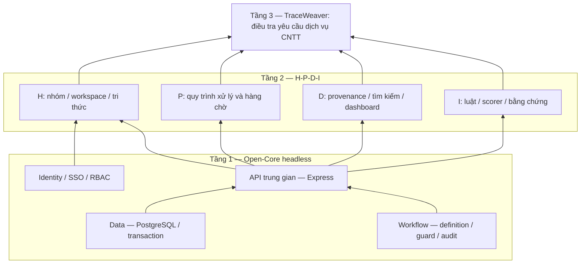

# TraceWeaver

BE-38 (29/10/2026): đã deploy BE + model AI v2 lên Oracle tại https://api.quizlearn.tech/docs/, runtime release `oracle-4e2805e`. API gọi scorer bằng TLS nội bộ, AI không publish cổng Internet. Pass 23 mẫu scorer qua TLS, 20 kiểm tra hybrid/PKCE/audit/replay/dữ liệu và 49 kiểm tra live hiện có. Hashes của 72 events, 25 runs và 25 cases cũ giữ nguyên; test thêm đúng một run hybrid, không thêm event/case. PostgreSQL/Keycloak và các ứng dụng khác giữ nguyên. Xem [hướng dẫn deploy](deploy/oracle/README.md). Các ghi chú container cũ bên dưới mô tả lịch sử hoặc container local8080, không phải deployment Oracle mới.

BE-34 (28/10): đã tích hợp model thử nghiệm từ AI_BE_RUNTIME_V2 theo cấu hình opt-in; extractor Node pass 42/42 fixture, 23 cặp HTTP khớp mẫu. Kiểm tra 129 BE/contract + 31 Python + 50 DB + 47 identity/API pass, không skip; có JWT/API→model→PostgreSQL, audit/replay/review/fallback. Model chỉ chấm các cạnh pending đã qua guard; chất lượng synthetic chưa đạt mục tiêu precision. Container API vẫn dùng image cũ. Xem [cấu hình scorer](backend/SCORER.md). Các ghi chú cũ bên dưới chỉ áp dụng khi không bị cập nhật này thay thế.

Base dự án tái dựng hành trình yêu cầu cấp môi trường thực hành từ dấu vết của ba dịch vụ intake, account và provision, định hướng DX-Lab HaUI 2026.

Hiện trạng nhánh phát triển, kết quả kiểm và giới hạn deployment được giữ tại [CURRENT_STATUS](docs/CURRENT_STATUS.md). Sau sửa audit:73 unit/HTTP/contract,49 DB,45 identity-native pass; npm audit0. Source sửa không tự cập nhật container đang chạy.

## Cấu trúc

```text
backend/
  src/           # Express, services và headless core
  scripts/       # Thiết lập môi trường và migration
  tests/         # Backend, contract và DB integration
  contracts/     # OpenAPI, JSON Schema và fixtures
  package.json
frontend/        # Giao diện, cấu hình và tests riêng
ai/              # Scorer Python, model có version, features và tests
simulator/       # Scenarios, fixtures và nguồn dữ liệu giả lập
docs/            # Mục lục tài liệu, hiện trạng và hướng dẫn tích hợp
.planning/       # Kế hoạch và trạng thái làm việc local (Git ignore)
.local/          # Gói bàn giao, báo cáo, công cụ và môi trường local (Git ignore)
.github/         # Issue/PR templates và CI
```

Điểm bắt đầu đọc tài liệu: [docs/README.md](docs/README.md). Source chạy nằm trong `backend/`, `frontend/`, `ai/` và `simulator/`; mỗi thành phần giữ cấu hình/tests của mình. Model AI đang dùng nằm ở `ai/artifacts/sandbox-v2/`.

Gói AI bàn giao gốc được lưu tại `ai/handoffs/AI_BE_RUNTIME_V2/`. Báo cáo local nằm trong `.local/reports/`, script kiểm/demo dùng riêng nằm trong `.local/scripts/`, bản nháp release/PR nằm trong `.local/releases/`. Bộ test AI đang chạy và payload để thử bằng Swagger vẫn ở `.local/ai-test/`. `.env`, credentials local, lockfile và Compose giữ ở root theo đường dẫn khởi động hiện tại.

Backend dùng JavaScript ES modules, Express và PostgreSQL. Đã có foundation, Keycloak local/Swagger PKCE login, JWT/JWKS, batch ingestion, GET /me, sources, knowledge, events, event detail và [run/graph, review/manual links](backend/RECONSTRUCTION.md) với quyền từ DB, snapshot, version và audit. [Case/workflow](backend/CASES.md) đã có 5 API; [dashboard](backend/DASHBOARD.md) có số đếm cùng scope và bộ lọc thời gian cho case drill-down. [Core workflow HTTP](backend/WORKFLOW.md) có ba API dùng app JWT riêng và JWT người dùng được kiểm độc lập; OpenAPI có20 Node operations và1 private Python scorer đã implemented trong source. Model v2 cần opt-in; baseline vẫn rule_only/degraded. Phạm vi triển khai hiện tại là BE.

Chạy API bằng Docker sau bước [chuẩn bị Keycloak/demo](backend/KEYCLOAK.md): `docker compose up -d --build --wait api`. Mặc định API tại `http://localhost:8080`; đăng nhập Swagger bằng **Authorize → keycloakLogin**. Máy hiện tại đã chuẩn bị xong; mật khẩu nằm trong `demo-credentials.local.json` bị Git ignore. Chi tiết tại [Docker API](backend/DOCKER.md).

## Chạy backend

Yêu cầu Node.js 24.14.1, npm 11.11.0 và PostgreSQL 17 hoặc Docker Compose.

```sh
npm ci
npm run db:setup
# Chỉ cần pull khi máy chưa có image PostgreSQL:
docker compose -f compose.dev.yaml pull postgres
npm run db:up
npm run db:migrate
npm run dev:be
```

Nếu đã có `.env`, bỏ qua `db:setup`; bổ sung CURSOR_SECRET ngẫu nhiên ≥32 ký tự nếu thiếu và giữ DB credentials. Xem [cấu hình Identity phía BE](backend/IDENTITY.md). Có thể dùng PostgreSQL riêng bằng DATABASE_URL.

- `GET http://127.0.0.1:8080/health/live`: tiến trình hoạt động.
- `GET http://127.0.0.1:8080/health/ready`: DB và migrations sẵn sàng.
- `npm test`: unit, HTTP và contract tests, không cần DB.
- `npm run test:db`: integration, cần PostgreSQL và quyền tạo DB test.
- `npm run test:identity`: JWT/quyền nguồn qua PostgreSQL và Postman CLI >=1.74.0, không chạy FE/AI.
- `npm run start:be`: chạy backend không watch.
- `npm run db:stop`: dừng DB và giữ dữ liệu.

PowerShell có thể dùng `npm.cmd`. Makefile cung cấp lệnh tương đương cho môi trường có GNU Make.

## Ranh giới kiến trúc

Core cung cấp Identity/Data/Workflow dùng chung, không phụ thuộc UI. Backend là lớp HTTP trung gian. Identity/Data, dữ liệu có provenance, review và case/workflow có audit đã có runtime. Cùng engine chạy case_handling/document_review headless và qua core HTTP với app/user JWT, quyền hiện tại, guard và audit transaction. Scorer còn planned. Base hiện tại chưa phải sản phẩm hoàn chỉnh hoặc bằng chứng đạt nghiệm thu bài thi.

Xem [cài đặt](INSTALL.md), [đóng góp](CONTRIBUTING.md), [bảo mật](SECURITY.md) và [API contracts](backend/contracts/README.md).

Mã nguồn dự án dùng [Apache-2.0](LICENSE). Dependency giữ giấy phép riêng; xem [bảng dependency/license](backend/DEPENDENCIES.md) và [thông báo bên thứ ba](backend/THIRD_PARTY_NOTICES.txt).

## Kiến trúc DX-OS ba tầng



Sơ đồ mô tả ranh giới kiến trúc mục tiêu. Luồng gọi khi triển khai: giao diện → API → Identity kiểm quyền → service nghiệp vụ → core Data/Workflow; scorer chỉ nhận dữ liệu đã được lọc quyền. Core không import Express hoặc giao diện và phải có thể tái sử dụng cho nghiệp vụ khác.

| Thành phần | Hiện trạng bộ khung | Phần cần triển khai tiếp |
|---|---|---|
| API trung gian | Express,20 operations có auth, health/body bounds, CORS allowlist | Scorer adapter và tích hợp FE |
| Data | PostgreSQL,7 migrations, repositories/transactions/snapshot/provenance | Raw parsers/dataset/backup restore |
| Identity | Local Keycloak PKCE; JWT/JWKS user/ingest/core và DB grants | Production SSO, FE login UI |
| Workflow | Hai definitions, shared engine/HTTP, guard/history/audit | UI và full E2E |
| H-P-D-I / ứng dụng | BE workspace/knowledge/cases/search/dashboard | Frontend/runtime/screens |
| Intelligence | Rule engine/version/evidence/unresolved, degraded fallback | Scorer/features/model/evaluation |
| Dữ liệu demo | Fixtures kiểm schema synthetic | Dataset có provenance/manifest và kịch bản đầu-cuối |

## API và tài khoản demo

Health API tại [health.openapi.json](backend/contracts/health.openapi.json). [openapi.json](backend/contracts/openapi.json) đánh dấu20 operation implemented: GET /me, sources, knowledge, events, event detail; POST batch ingestion; POST run, GET run và graph; POST review và manual link; 5 API case/workflow; dashboard và3 API core workflow. Scorer còn planned. Run/link/case/dashboard/core đã kiểm HTTP/JWT/PostgreSQL với Postman JWKS simulation. BE-23 đã provision client core local, cấu hình CORE_APP_CLIENT_ID/CORE_APP_SUBJECT/membership và rebuild Docker API healthy. Verifier kiểm Authorization Code/PKCE/refresh cùng token user/ingest/core thật, hai workflow qua core HTTP và case history dùng chung; xem [KEYCLOAK.md](backend/KEYCLOAK.md) và [WORKFLOW.md](backend/WORKFLOW.md). Chưa nghiệm thu triển khai production.

Tài khoản local `demo.operator`/`demo.viewer` được seed theo [hướng dẫn Keycloak](backend/KEYCLOAK.md); mật khẩu sinh ngẫu nhiên nằm trong `demo-credentials.local.json` bị ignore. Không lưu mật khẩu/token thật trong repository.

## Kiểm chứng và phát triển

```sh
npm run check:base
npm run licenses:check
npm test
# Sau khi DB đã khởi động và migrate:
npm run smoke
npm run test:db
```

CI kiểm bộ khung và tests trên Linux/Windows; job PostgreSQL kiểm migration, integration và health readiness thật. `npm run licenses` cập nhật bảng dependency và nguyên văn license từ các package đã cài; `licenses:check` phát hiện dữ liệu bị lệch lockfile.

[Issue tracker](https://github.com/HaUI-HIT-Tam-Thai-T/TraceWeaver/issues) tiếp nhận bug/feature. Bản `v0.1.0-base.1` đánh dấu bộ khung, không phải bản nghiệm thu sản phẩm. Yêu cầu chức năng của bài thi cần tiếp tục có code chạy, dữ liệu demo và bằng chứng kiểm thử thực tế.
