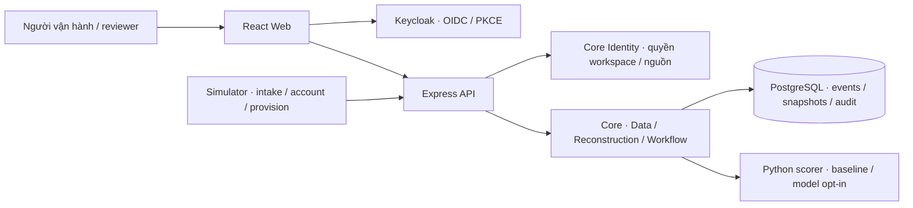

# TraceWeaver

**Từ log rời rạc đến hành trình yêu cầu có bằng chứng.**

[](https://github.com/HaUI-HIT-Tam-Thai-T/TraceWeaver/actions/workflows/ci.yml)
[](LICENSE)
[](package.json)

**Tiếng Việt** · [English](README_EN.md) · [Cài đặt](INSTALL.md) · [Tài liệu](docs/README.md) · [API contracts](backend/contracts/README.md)

TraceWeaver là dự án mã nguồn mở hỗ trợ điều tra yêu cầu cấp môi trường thực hành CNTT, định hướng DX-Lab HaUI 2026. Hệ thống ghép dấu vết từ ba nguồn **intake → account → provision**, giúp người vận hành tìm bước thất bại, xem bằng chứng, duyệt liên kết và theo dõi hồ sơ xử lý.

## Bài toán và cách giải quyết

Một yêu cầu có thể đi qua nhiều hệ thống, thiếu mã liên kết, nhận log muộn hoặc có nhiều lần thử lại. TraceWeaver lưu sự kiện cùng nguồn gốc, tái dựng hành trình theo luật và giữ riêng các trường hợp chưa đủ bằng chứng. Scorer AI hỗ trợ xếp hạng các cặp hợp lệ; người review quyết định liên kết và đóng hồ sơ.

| Khả năng | Nội dung |
|---|---|
| Thu thập và tra cứu | Batch ingestion, chống trùng, lọc sự kiện theo nguồn và thời gian, provenance |
| Tái dựng hành trình | Snapshot có phiên bản, luật kiểm tra ID/thứ tự/kết quả, đồ thị và trường hợp unresolved |
| Review và hồ sơ | Duyệt hoặc thêm liên kết, bằng chứng, chuyển trạng thái và audit |
| Sandbox thực hành | Mô phỏng lỗi RAM/image/tài khoản; sửa điều kiện, chạy lại và kiểm chứng kết quả |
| Workspace và quyền | Keycloak SSO/PKCE, vai trò và quyền đọc theo từng nguồn, API quản trị thành viên |
| Giao diện | React: dashboard, sự kiện, hồ sơ, tri thức và quản trị workspace |
| AI có kiểm soát | Baseline và model sandbox v2 opt-in; fallback khi scorer không khả dụng |

Source của các module trên đã có trong repo; mức tích hợp và triển khai phụ thuộc phiên bản. [CURRENT_STATUS](docs/CURRENT_STATUS.md) ghi bằng chứng theo từng mốc. Tag `v0.1.0-base.1` là bản scaffold cũ. Model hiện là thử nghiệm trên dữ liệu synthetic; chưa có bằng chứng đạt mục tiêu chất lượng trên dữ liệu đại diện. Xem [model card](ai/artifacts/sandbox-v2/README.md).

## Kiến trúc



Core cung cấp chức năng dùng chung không phụ thuộc UI; API là adapter HTTP; TraceWeaver áp dụng core cho điều tra yêu cầu lab. Scorer không ghi DB hoặc quyết định workflow. Chi tiết ba tầng Open-Core / H-P-D-I / ứng dụng tại [ARCHITECTURE.md](ARCHITECTURE.md).

## Bắt đầu

Yêu cầu backend: **Node.js 24.14.1**, **npm 11.11.0**, **PostgreSQL 17** hoặc Docker Compose v2. Frontend cài dependencies riêng; Python AI là thành phần tùy chọn.

```sh
git clone https://github.com/HaUI-HIT-Tam-Thai-T/TraceWeaver.git
cd TraceWeaver
npm ci
npm run db:setup
# Chỉ cần tải image nếu máy chưa có:
docker compose -f compose.dev.yaml pull postgres
npm run db:up
npm run db:migrate
npm run dev:be
```

API local mặc định: `http://127.0.0.1:8080`; kiểm `/health/live` và `/health/ready`. Health không yêu cầu đăng nhập; API nghiệp vụ cần Identity và quyền dữ liệu.

Tiếp tục theo [INSTALL.md](INSTALL.md) để cấu hình SSO, chạy web tại `http://localhost:5173`, bật AI và sinh dữ liệu demo. [Keycloak guide](backend/KEYCLOAK.md) hướng dẫn tạo tài khoản demo với mật khẩu ngẫu nhiên lưu local; không có mật khẩu chung trong repo. [Oracle deployment](deploy/oracle/README.md) dành cho vận hành máy chủ.

## Công nghệ và giấy phép

| Thành phần | Công nghệ | Thông tin giấy phép |
|---|---|---|
| Backend | JavaScript ES modules, Express, JOSE | [98 npm packages](backend/DEPENDENCIES.md) |
| Frontend | React, TypeScript, Vite, Tailwind, MUI, Radix UI | [Frontend inventory](frontend/DEPENDENCIES.md) |
| AI | Python, FastAPI, Pydantic; baseline và model JSON | [Python inventory](ai/DEPENDENCIES.md), [model provenance](ai/artifacts/sandbox-v2/README.md) |
| Dữ liệu / Identity | PostgreSQL 17, Keycloak | [Services và phạm vi kiểm kê](LICENSES.md) |
| Simulator | Node.js, dữ liệu synthetic có seed | [Simulator](simulator/README.md) |

Mã nguồn dự án theo **[Apache-2.0](LICENSE)**. Dependency, image và tài sản bên thứ ba giữ giấy phép riêng; xem [LICENSES.md](LICENSES.md) và [NOTICE](NOTICE).

## Kiểm chứng

```sh
npm run check:base
npm run licenses:check
npm run licenses:frontend:check
npm test
npm run test:sim
npm --prefix frontend test
```

Lệnh frontend cần dependencies tại `frontend/`. DB integration, identity, AI và UAT có yêu cầu riêng; xem [TESTING.md](TESTING.md). Badge CI dẫn tới workflow thực tế; kết quả local không thay thế kết quả của đúng commit trên GitHub.

## Cấu trúc và tài liệu

| Đường dẫn | Nội dung |
|---|---|
| [backend/](backend/README.md) | HTTP API, headless core, migrations, contracts và tests |
| [frontend/](frontend/README.md) | Web React, phiên SSO, các màn hình và tests |
| [ai/](ai/README.md) | Scorer, features, model, provenance và tests |
| [simulator/](simulator/README.md) | Mô phỏng nghiệp vụ và sinh log kiểm thử |
| [deploy/oracle/](deploy/oracle/README.md) | Triển khai và vận hành |
| [docs/](docs/README.md) | Mục lục, hiện trạng và hướng dẫn tích hợp |
| [.github/](.github/) | CI, mẫu issue và pull request |

Đọc thêm: [Kiến trúc](ARCHITECTURE.md) · [Changelog](CHANGELOG.md) · [Đóng góp](CONTRIBUTING.md) · [Quy tắc ứng xử](CODE_OF_CONDUCT.md) · [Bảo mật](SECURITY.md) · [Hỗ trợ](SUPPORT.md).

## Đóng góp và liên hệ

Báo lỗi hoặc đề xuất tính năng tại [Issues](https://github.com/HaUI-HIT-Tam-Thai-T/TraceWeaver/issues), kèm phiên bản và bước tái hiện với dữ liệu giả. Đọc [CONTRIBUTING.md](CONTRIBUTING.md) trước khi gửi PR. Vấn đề nhạy cảm theo [SECURITY.md](SECURITY.md).

Dự án thuộc tổ chức [HaUI-HIT-Tam-Thai-T](https://github.com/HaUI-HIT-Tam-Thai-T). Cấu trúc hồ sơ nguồn mở tham khảo [DX-OS của HaUI-ImplSolution](https://github.com/HaUI-ImplSolution/DX-OS); nội dung mô tả, license và hiện trạng ở đây dành riêng cho TraceWeaver.
