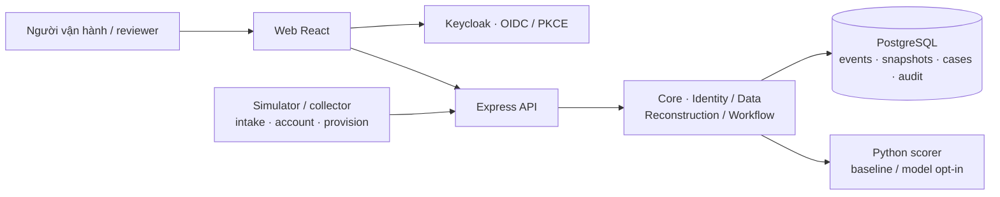
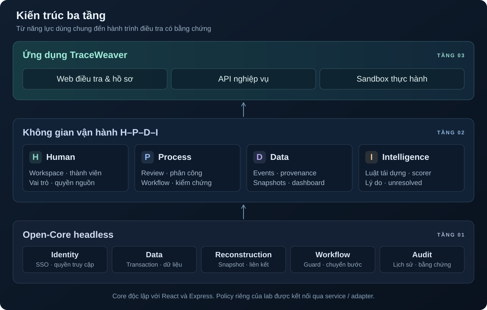

<p align="center">
  
</p>

<p align="center"><strong>Từ log rời rạc đến hành trình yêu cầu có bằng chứng.</strong></p>

<p align="center">
  <a href="./LICENSE"></a>
  <a href="https://github.com/HaUI-HIT-Tam-Thai-T/TraceWeaver/actions/workflows/ci.yml"></a>
  
</p>

<div align="center">

[Khám phá demo](./docs/DEMO.md) &nbsp; · &nbsp; [Cài đặt](./INSTALL.md) &nbsp; · &nbsp; [API](https://api.quizlearn.tech/docs/) &nbsp; · &nbsp; [Tài liệu](./docs/README.md)

**Tiếng Việt** · [English](./README_EN.md)

</div>

---

## 💡 Giới thiệu

Một yêu cầu cấp môi trường đi qua nhiều dịch vụ có thể thiếu mã liên kết, nhận log muộn hoặc có nhiều lần thử lại.
TraceWeaver tập hợp sự kiện, tái dựng quan hệ và giữ lại các trường hợp chưa đủ căn cứ để người review quyết định.

> **Điều tra → Review → Khắc phục → Kiểm chứng**

**Hiểu hành trình.** Nối dấu vết intake, account và provision, đối chiếu bằng chứng và giữ riêng nhánh chưa đủ căn cứ.

**Theo dõi hồ sơ.** Phân công người xử lý, bổ sung bằng chứng và chuyển bước theo workflow có lịch sử quyết định.

**Xác nhận kết quả.** Sửa điều kiện sandbox, chạy lại yêu cầu và kiểm tra bằng chứng nguồn mới trước khi đóng hồ sơ.

## ✨ Điểm nổi bật

- **Truy vết có căn cứ:** sự kiện giữ provenance; run có snapshot; review, hồ sơ và chuyển trạng thái có lịch sử/audit.
- **Giữ nguyên sự mơ hồ:** thiếu ID, ID mâu thuẫn hoặc nhiều nhánh hợp lệ được giữ unresolved; hệ thống không ép chọn chỉ vì điểm AI cao.
- **AI có kiểm soát:** backend lọc cặp theo quyền và guard trước khi gọi scorer; reviewer quyết định liên kết; có fallback khi scorer không khả dụng.
- **Kiểm chứng việc khắc phục:** tái dựng phân tích log đã có, chạy lại sandbox sinh lần thực thi mới, proof xác nhận kết quả phù hợp trước khi đóng hồ sơ.
- **Phân quyền tới từng nguồn:** Keycloak cung cấp SSO; backend kiểm membership, role và quyền đọc nguồn hiện tại khi truy cập sự kiện, run và hồ sơ.
- **Core có thể tái sử dụng:** Identity, Data và Workflow tách khỏi giao diện và adapter HTTP.
- **Nguồn mở minh bạch:** Apache-2.0, inventory và notices theo từng hệ sinh thái, SBOM CycloneDX và lệnh kiểm drift.

## 🖥️ Giao diện

Web React tổ chức theo workspace, dùng phiên đăng nhập Keycloak và quyền do backend trả về.

| Màn hình | Đường dẫn | Nội dung |
|---|---|---|
| Tổng quan | `/dashboard` | Thống kê và điều hướng tới hồ sơ trong phạm vi được phép |
| Sự kiện | `/events`, `/events/:eventId` | Tìm/lọc log, xem chi tiết và provenance, bắt đầu tái dựng |
| Hồ sơ | `/cases`, `/cases/:caseId` | Theo dõi trạng thái, run/đồ thị, review, bằng chứng và sandbox |
| Tri thức | `/knowledge` | Tra cứu tri thức theo workspace |
| Quản trị workspace | `/workspace-admin` | Thành viên, vai trò, quyền nguồn và cấp tài khoản theo cấu hình |

Hướng dẫn phiên đăng nhập và API client ở [frontend/README.md](./frontend/README.md).
Kịch bản thao tác cùng kết quả cần quan sát ở [docs/DEMO.md](./docs/DEMO.md).

## 🗺️ Kiến trúc tổng thể



Web gọi API để tra cứu, tái dựng và xử lý hồ sơ.
API kiểm danh tính/quyền, sử dụng core để xử lý nghiệp vụ và lưu dữ liệu trong PostgreSQL.
Scorer nhận các cặp sự kiện đã lọc quyền; không có quyền ghi DB hoặc quyết định workflow.
Vai trò module và luồng dữ liệu ở [ARCHITECTURE.md](./ARCHITECTURE.md).

## 🧱 Kiến trúc 3 tầng



Các mũi tên thể hiện năng lực được xây từ core lên ứng dụng, không phải thứ tự gọi HTTP.

| Tầng | Thành phần |
|---|---|
| **1. Open-Core** — không có giao diện người dùng | Identity (SSO, quyền workspace/nguồn), Data (transaction, lưu trữ), Reconstruction (snapshot, luật liên kết), Workflow (guard, chuyển bước) và audit |
| **2. H-P-D-I** | Bốn không gian **Human, Process, Data, Intelligence** được tổ chức từ các năng lực core, kết hợp tri thức, dashboard và scorer tùy chọn |
| **3. Ứng dụng** | **TraceWeaver** — Web điều tra và quản lý hồ sơ, API nghiệp vụ, sandbox cấp môi trường thực hành |

| Không gian | Điều tra và xử lý hồ sơ | Sandbox và kiểm chứng |
|---|---|---|
| **H — Human** | Workspace, thành viên, vai trò và quyền đọc từng nguồn; tri thức hỗ trợ người vận hành | Operator điều tra, admin sửa điều kiện, reviewer kiểm chứng và quyết định đóng theo quyền |
| **P — Process** | Tạo run, review liên kết, phân công hồ sơ, bổ sung bằng chứng và chuyển trạng thái có guard | Sửa điều kiện → chạy lại yêu cầu → giao log → kiểm chứng nguồn → đóng hồ sơ khi đủ điều kiện |
| **D — Data** | Sự kiện đa nguồn, provenance, snapshot hành trình, lịch sử/audit và dashboard | Trạng thái RAM/image/tài khoản, các lần thực thi, log delivery và proof được lưu để đối chiếu |
| **I — Intelligence** | Luật tái dựng, scorer hỗ trợ đánh giá cặp hợp lệ; giữ unresolved khi chưa đủ căn cứ | Đối chiếu kết quả thực thi và bằng chứng nguồn theo điều kiện hiện tại; điểm AI không thay thế proof |

Xem [kiến trúc chi tiết](./ARCHITECTURE.md) và [ranh giới core](./backend/src/core/README.md).

## 🧩 Tính năng

**Thu thập và điều tra:** batch ingestion, chống trùng/xung đột sự kiện, lọc theo nguồn và thời gian, provenance, tạo run có snapshot, đồ thị hành trình, guard ID/thứ tự/kết quả, unresolved và review/thêm liên kết.

**Hồ sơ và vận hành:** phân công, bổ sung bằng chứng, chuyển trạng thái có kiểm version/quyền, lịch sử/audit, dashboard, tri thức và quản trị thành viên/quyền nguồn.

**Sandbox và AI:** mô phỏng lỗi RAM/image/tài khoản, sửa điều kiện, chạy lại request, theo dõi giao log và lưu proof; scorer baseline hoặc model sandbox v2 opt-in, có fallback.

Mức tích hợp và bằng chứng từng tính năng ở [FEATURE_STATUS](./docs/FEATURE_STATUS.md); lịch sử triển khai ở [CURRENT_STATUS](./docs/CURRENT_STATUS.md).
Model sandbox v2 đang thử nghiệm trên dữ liệu synthetic; chất lượng và giới hạn được ghi tại [model card](./ai/artifacts/sandbox-v2/README.md).

## 🧰 Công nghệ và giấy phép

| Thành phần | Công nghệ | Giấy phép / tài liệu kiểm kê |
|---|---|---|
| Backend | Node.js 24, JavaScript ES modules, Express, JOSE | Mã dự án Apache-2.0; [npm inventory](./backend/DEPENDENCIES.md) |
| Web | React, TypeScript, Vite, Tailwind, MUI, Radix UI | Mã dự án Apache-2.0; [frontend inventory](./frontend/DEPENDENCIES.md) |
| AI Service | Python, FastAPI, Pydantic, model JSON | Mã dự án Apache-2.0; thư viện MIT, BSD, Apache-2.0, PSF; [Python inventory](./ai/DEPENDENCIES.md) |
| SSO | Keycloak | Apache-2.0; phiên bản/digest ở [runtime inventory](./backend/DEPENDENCIES.md#runtime-and-services) |
| Dữ liệu | PostgreSQL 17 | PostgreSQL License |
| Simulator | Node.js, bộ sinh dữ liệu synthetic có seed | Mã dự án Apache-2.0; [simulator](./simulator/README.md) |

Mã nguồn dự án theo [Apache-2.0](./LICENSE); dependency và tài sản bên thứ ba giữ giấy phép riêng.
Danh sách, notices và phạm vi phân phối ở [LICENSES.md](./LICENSES.md); SBOM CycloneDX ở [sbom/](./sbom/README.md).

## 🚀 Cài đặt và chạy

### 💻 Yêu cầu hệ thống

<details>
<summary>Yêu cầu công cụ và cổng kết nối</summary>

| Hạng mục | Yêu cầu | Ghi chú |
|---|---|---|
| Source | Git | Clone repository |
| Backend / simulator | Node.js 24.14.1, npm 11.11.0 | Phiên bản theo cấu hình dự án |
| Database | PostgreSQL 17 | Có thể dùng Docker Compose v2 hoặc DB riêng |
| Web | Node/npm và trình duyệt | Cài dependencies riêng tại `frontend/` |
| AI tùy chọn | Python và venv theo [AI RUN](./ai/RUN.md) | Cài đúng pinned requirements |
| Cổng local | API 8080, PostgreSQL 55432, Keycloak 8081, web 5173 | Có thể thay đổi nếu cập nhật đồng bộ cấu hình |

</details>

### 📝 Các bước

Chạy backend với PostgreSQL qua Docker:

```sh
git clone https://github.com/HaUI-HIT-Tam-Thai-T/TraceWeaver.git
cd TraceWeaver
npm ci
npm run db:setup                         # tạo .env khi chưa có
docker compose -f compose.dev.yaml pull postgres  # khi chưa có image
npm run db:up
npm run db:migrate
npm run dev:be
```

Nếu đã có `.env`, giữ credentials và cấu hình hiện tại; dùng DB riêng thì đặt `DATABASE_URL` và bỏ các bước Docker PostgreSQL.
API nghiệp vụ cần Identity và quyền dữ liệu: tiếp tục mục **Fresh checkout/bootstrap** tại [KEYCLOAK.md](./backend/KEYCLOAK.md).
Cài đặt đầy đủ ở [INSTALL.md](./INSTALL.md).

```sh
npm run start:be                        # chạy BE không watch
npm run db:stop                         # dừng DB, giữ dữ liệu
```

PowerShell có thể dùng `npm.cmd` nếu execution policy chặn `npm.ps1`.

### 🛠️ Chạy và build từng thành phần

Các lệnh dưới đây chạy từ root repository.

| Thành phần | Chuẩn bị | Chạy / kiểm tra |
|---|---|---|
| Backend | `npm ci`, cấu hình DB/Identity và migrate | `npm run dev:be` hoặc `npm run start:be` |
| Web | `npm --prefix frontend ci`, tạo env từ mẫu | `npm --prefix frontend run dev`; build bằng `npm --prefix frontend run build` |
| AI Service | Tạo venv, cài `ai/requirements.txt` theo [AI RUN](./ai/RUN.md) | Chạy `python -m ai.app` bằng interpreter của venv, với env scorer hợp lệ |
| Simulator | Node.js và cấu hình theo [simulator README](./simulator/README.md) | `npm run sim:generate` in manifest; ghi dataset khi chỉ định `--out` |

Web development mặc định ở `http://localhost:5173`.
Tạo `frontend/.env.development.local` từ [frontend/.env.example](./frontend/.env.example), rồi chạy Vite.
Frontend hiện yêu cầu API và Identity HTTPS; backend HTTP local cần endpoint HTTPS phù hợp để web kết nối.
Chi tiết origins/callback ở [INSTALL.md](./INSTALL.md#4-frontend).

### 🔧 Cấu hình

<details>
<summary>Các biến môi trường cần cấu hình</summary>

Backend dùng `.env` tại root; web dùng các file env của Vite.
Mẫu cấu hình: [.env.example](./.env.example) và [frontend/.env.example](./frontend/.env.example).

| Biến | Ý nghĩa |
|---|---|
| `DATABASE_URL`, `POSTGRES_*` | Kết nối và credentials PostgreSQL |
| `CURSOR_SECRET` | Khóa cursor ngẫu nhiên tối thiểu 32 ký tự |
| `OIDC_ISSUER`, `OIDC_CLIENT_ID`, `OIDC_API_AUDIENCE` | Provider và kiểm JWT của API |
| `FRONTEND_ORIGINS`, `FRONTEND_LOCAL_ORIGINS` | Danh sách exact browser origins được phép theo môi trường |
| `CORE_APP_CLIENT_ID`, `CORE_APP_SUBJECT` | Danh tính ứng dụng cho core workflow HTTP |
| `SCORER_URL`, `SCORER_SERVICE_SECRET`, `SCORER_MODEL_VERSION` | Adapter scorer và opt-in model phía backend |
| `LAB_INGEST_SUBJECT` | Subject dịch vụ collector để giao log sandbox |
| `VITE_API_BASE_URL` | HTTPS origin API cho web, không gồm `/api/v1` |
| `VITE_KEYCLOAK_URL`, `VITE_KEYCLOAK_REALM`, `VITE_KEYCLOAK_CLIENT_ID` | Cấu hình public client SSO cho web |

Không đưa mật khẩu, token hoặc client secret vào Git hay biến `VITE_*`.
Cấu hình scorer Python riêng và model opt-in ở [SCORER.md](./backend/SCORER.md).

</details>

## 🌐 Chạy thử

| Dịch vụ | Địa chỉ | Đăng nhập / điều kiện |
|---|---|---|
| Web development | [localhost:5173](http://localhost:5173) | Chạy Vite; đăng nhập Keycloak và có quyền workspace |
| Swagger trên server | [api.quizlearn.tech/docs](https://api.quizlearn.tech/docs/) | Authorize theo cấu hình deployment |
| API local | [127.0.0.1:8080](http://127.0.0.1:8080/health/live) | `/health/live` và `/health/ready` public; nghiệp vụ cần JWT/quyền |
| Swagger local | [localhost:8080/docs](http://localhost:8080/docs/) | **Authorize → keycloakLogin**, sau bootstrap |
| Keycloak local | [localhost:8081](http://localhost:8081) | Sau bước bootstrap local; credentials riêng trên máy |

### 🌐 Máy chủ công khai

Backend và scorer có hướng dẫn triển khai tại [deploy/oracle/README.md](./deploy/oracle/README.md).
Cấu hình CORS/callback đã đăng ký không tự chứng minh web đã triển khai; đối chiếu phiên bản và phạm vi bản chạy tại [CURRENT_STATUS](./docs/CURRENT_STATUS.md).

### 🔑 Tài khoản demo

Bootstrap local tạo credentials ngẫu nhiên trong `demo-credentials.local.json`, được Git ignore.

| Tài khoản local | Vai trò | Credentials |
|---|---|---|
| `demo.operator` | Điều tra và thao tác theo quyền operator được seed | Xem file credentials local sau bootstrap |
| `demo.viewer` | Chỉ đọc trong phạm vi được cấp | Xem file credentials local sau bootstrap |

Quyền reviewer/admin và sandbox cần được cấu hình theo môi trường.
Làm theo [kịch bản demo](./docs/DEMO.md) để thử log thiếu ID, nhánh mơ hồ và sửa điều kiện rồi chạy lại request.

## 🔌 API

<details>
<summary>Xem xác thực và các nhóm API</summary>

- Swagger local ở `/docs/`; hợp đồng chung ở [backend/contracts/openapi.json](./backend/contracts/openapi.json) và [JSON Schemas](./backend/contracts/README.md).
- API người dùng dùng `Authorization: Bearer <access token>`; ingestion và core workflow có danh tính dịch vụ riêng.
- Backend kiểm role/quyền nguồn hiện tại; token hợp lệ chưa đủ để đọc mọi workspace.
- Các thao tác có version/idempotency phải dùng đúng contract; lỗi chứa mã lỗi và request ID để đối chiếu.

| Nhóm | Đường dẫn / tài liệu |
|---|---|
| Danh tính và nguồn | `GET /api/v1/me`, `/api/v1/workspaces/{wid}/sources`; [Identity](./backend/IDENTITY.md) |
| Events và ingestion | `/api/v1/workspaces/{wid}/events`, `/sources/{sid}/events:batch`; [Ingestion](./backend/INGESTION.md), [Events](./backend/EVENTS.md) |
| Runs và review | `/api/v1/workspaces/{wid}/runs`; [Reconstruction](./backend/RECONSTRUCTION.md) |
| Hồ sơ và workflow | `/api/v1/workspaces/{wid}/cases`; [Cases](./backend/CASES.md), [Core workflow](./backend/WORKFLOW.md) |
| Sandbox và proof | [LAB_SANDBOX.md](./backend/LAB_SANDBOX.md) |
| Dashboard và quản trị | [Dashboard](./backend/DASHBOARD.md), [Workspace admin](./backend/WORKSPACE_ADMIN.md) |
| AI scorer | API nội bộ cho backend; [SCORER.md](./backend/SCORER.md) |

</details>

## 🧪 Kiểm thử

- Backend unit/HTTP/contract: `npm test`; contracts riêng: `npm run test:contracts`.
- PostgreSQL: `npm run test:db`; Identity/HTTP/DB: `npm run test:identity:native`.
- Web: `npm --prefix frontend test`, `npm --prefix frontend run lint`, `npm --prefix frontend run build`.
- Simulator: `npm run test:sim`; AI: `python -m unittest discover -s ai/tests` trong venv.
- License và cấu trúc: `npm run check:base`, `npm run licenses:check`, `npm run licenses:frontend:check`.
- SBOM: `npm run sbom:check`; Python license/SBOM: `python -m ai.scripts.dependency_inventory --check` trong venv.

Điều kiện chạy, phân biệt unit/integration/UAT và giới hạn bằng chứng ở [TESTING.md](./TESTING.md).
Độ phủ theo tính năng ở [FEATURE_STATUS](./docs/FEATURE_STATUS.md); kết quả CI theo đúng commit tại [Actions](https://github.com/HaUI-HIT-Tam-Thai-T/TraceWeaver/actions).
SBOM frontend loại dependency optional; Python SBOM là danh mục phẳng — xem [phạm vi SBOM](./sbom/README.md).

## 🐛 Xử lý sự cố

| Dấu hiệu | Cách kiểm tra |
|---|---|
| PowerShell chặn `npm.ps1` | Dùng `npm.cmd` |
| API ready trả 503 | Kiểm DB, `DATABASE_URL` và migration; xem [Docker guide](./backend/DOCKER.md) |
| Login/callback lỗi | Kiểm issuer, public client, exact origin và `/auth/callback`; xem [Keycloak](./backend/KEYCLOAK.md) |
| Web không gọi được API | API base phải là HTTPS origin; kiểm env và CORS cho localhost:5173 |
| Không đọc được run/case cũ | Kiểm membership và quyền hiện tại của mọi nguồn trong snapshot |
| Hybrid degraded | Kiểm scorer URL, credential, readiness và opt-in version |
| Sửa sandbox nhưng chưa đóng được hồ sơ | Kiểm request đã chạy lại, log đã giao và proof còn phù hợp |
| Inventory/SBOM stale | Sinh lại bằng công cụ tương ứng tại [LICENSES](./LICENSES.md) và [SBOM](./sbom/README.md) |

Hỗ trợ và cách gửi log an toàn tại [SUPPORT.md](./SUPPORT.md).

## 📁 Cấu trúc repository

<details>
<summary>Xem cấu trúc thư mục và tài liệu</summary>

| Thư mục | Nội dung |
|---|---|
| [`backend/`](./backend/README.md) | Express API, core headless, migrations, contracts và tests |
| [`frontend/`](./frontend/README.md) | Web React, SSO, các màn hình và tests |
| [`ai/`](./ai/README.md) | Scorer, features, model/version, provenance và tests |
| [`simulator/`](./simulator/README.md) | Mô phỏng nghiệp vụ có trạng thái và sinh log có seed |
| [`deploy/oracle/`](./deploy/oracle/README.md) | Triển khai và vận hành máy chủ |
| [`docs/`](./docs/README.md) | Hướng dẫn demo, bằng chứng và tích hợp |
| [`sbom/`](./sbom/README.md) | CycloneDX JSON và hướng dẫn tái tạo |
| [`.github/`](./.github/) | CI, kiểm dependency và mẫu issue/PR |

Tài liệu gốc: [ARCHITECTURE](./ARCHITECTURE.md) · [INSTALL](./INSTALL.md) · [CHANGELOG](./CHANGELOG.md) · [LICENSES](./LICENSES.md).
Chuẩn bị gói source và bản phân phối theo [RELEASING](./docs/RELEASING.md).
Tag `v0.1.0-base.1` là scaffold cũ; phạm vi hiện tại theo revision ở [CURRENT_STATUS](./docs/CURRENT_STATUS.md).

</details>

## 🤝 Đóng góp

- **Báo lỗi:** [tạo bug report](https://github.com/HaUI-HIT-Tam-Thai-T/TraceWeaver/issues/new?template=bug_report.md), kèm revision và bước tái hiện.
- **Đề xuất tính năng:** [tạo feature request](https://github.com/HaUI-HIT-Tam-Thai-T/TraceWeaver/issues/new?template=feature_request.md).
- **Gửi mã:** đọc [CONTRIBUTING.md](./CONTRIBUTING.md) và tuân theo [CODE_OF_CONDUCT.md](./CODE_OF_CONDUCT.md).
- **Vấn đề nhạy cảm:** theo [SECURITY.md](./SECURITY.md); dùng dữ liệu giả và loại secret khỏi log/ảnh công khai.

## 📞 Liên hệ

| Đầu mối | Kênh |
|---|---|
| Đội phát triển | [HaUI-HIT-Tam-Thai-T](https://github.com/HaUI-HIT-Tam-Thai-T) |
| Hỗ trợ, báo lỗi và thảo luận kỹ thuật | [GitHub Issues](https://github.com/HaUI-HIT-Tam-Thai-T/TraceWeaver/issues) |

## 📜 Giấy phép

Apache License 2.0, xem [LICENSE](./LICENSE) và [NOTICE](./NOTICE).
Dependency, model và dữ liệu có thông tin nguồn gốc/phạm vi riêng tại [LICENSES.md](./LICENSES.md) và [model card](./ai/artifacts/sandbox-v2/README.md).
