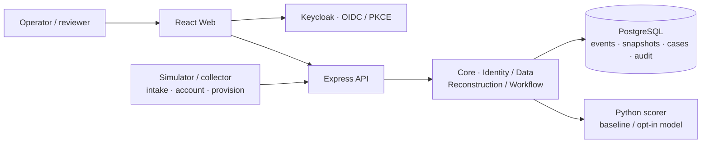

# TraceWeaver: Reconstruct request journeys from multi-source logs

[Tiếng Việt](./README.md) · **English**

[](./LICENSE)
[](https://github.com/HaUI-HIT-Tam-Thai-T/TraceWeaver/actions/workflows/ci.yml)

**Team:** [HaUI-HIT-Tam-Thai-T](https://github.com/HaUI-HIT-Tam-Thai-T) · **Project context:** DX-Lab HaUI 2026

**Deployed API:** [api.quizlearn.tech/docs](https://api.quizlearn.tech/docs/)

**Documentation:** [Index](./docs/README.md) · [Guided demo](./docs/DEMO.md) · [Features and evidence](./docs/FEATURE_STATUS.md)

TraceWeaver is open-source software for investigating IT lab provisioning requests.
It connects traces across **intake → account → provision** into evidence-backed journeys, helping operators locate failures, manage cases and verify remediation.

## 💡 Introduction

A provisioning request crosses multiple services and may have missing identifiers, delayed logs or repeated attempts.
TraceWeaver collects events, reconstructs their relationships and preserves inconclusive cases for human review.

| Component | Problem | Main flow |
|---|---|---|
| Journey investigation | Logs are scattered across sources; the failing step is unclear | Find an event → create a run → inspect graph/evidence → review links |
| Case management | Ownership, progress and decisions need a durable record | Open a case from a run → assign → add evidence → follow guarded workflow |
| Lab sandbox | A repaired condition needs a verified outcome | Repair RAM/image/account conditions → rerun request → deliver logs → verify source evidence → close case |

## ✨ Highlights

- **Traceable evidence:** events retain provenance, runs preserve snapshots, and review/case/workflow decisions retain history and audit records.
- **Explicit uncertainty:** missing or conflicting identifiers and multiple plausible branches remain unresolved for review.
- **Controlled AI assistance:** backend authorization and guards filter candidate pairs before scoring; reviewers decide links; scorer failures have a fallback.
- **Verified remediation:** reconstruction analyzes existing logs, sandbox reruns create new attempts, and source proof verifies the outcome before closure.
- **Source-level authorization:** Keycloak provides SSO; backend checks current membership, roles and source grants when reading events, runs and cases.
- **Reusable core:** Identity, Data and Workflow are separated from the UI and HTTP adapters.
- **Transparent open source:** Apache-2.0, per-ecosystem inventories/notices, CycloneDX SBOMs and drift checks.

## 🖥️ Interface

The React web app is organized by workspace, using Keycloak sessions and permissions supplied by the backend.

| Screen | Route | Purpose |
|---|---|---|
| Dashboard | `/dashboard` | Scoped statistics and navigation into cases |
| Events | `/events`, `/events/:eventId` | Search/filter logs, inspect provenance and start reconstruction |
| Cases | `/cases`, `/cases/:caseId` | Status, run/graph, review, evidence and sandbox operations |
| Knowledge | `/knowledge` | Workspace knowledge |
| Workspace administration | `/workspace-admin` | Membership, roles, source grants and configured account provisioning |

Session and API-client guidance is in [frontend/README.md](./frontend/README.md).
Follow [docs/DEMO.md](./docs/DEMO.md) for a walkthrough with observable results.

## 🗺️ System architecture



The web app calls the API to search events, reconstruct journeys and manage cases.
The API validates identity/authorization, delegates business operations to the core and persists data in PostgreSQL.
The scorer receives authorized candidate pairs and cannot write the database or decide workflow actions.
Module responsibilities and data flows are described in [ARCHITECTURE.md](./ARCHITECTURE.md).

## 🧱 Three-layer architecture

| Layer | Components | TraceWeaver responsibility |
|---|---|---|
| 1. Headless Open-Core | Identity, Data, Reconstruction, Workflow and audit | Authorization, transactions, snapshots and shared engines |
| 2. H-P-D-I | Human, Process, Data, Intelligence | Compose core capabilities into operational workspaces |
| 3. Application | TraceWeaver Web, business APIs and sandbox | Investigate lab provisioning requests |

| Space | Application in TraceWeaver |
|---|---|
| **H** — Human | Workspaces, membership, roles, source grants and knowledge |
| **P** — Process | Link review, case assignment, workflows and verification before closure |
| **D** — Data | Events, provenance, snapshots, search and dashboards |
| **I** — Intelligence | Reconstruction rules, optional scoring, explanations and unresolved cases |

The core is independent of React/Express; lab-case policies are connected through business services/adapters.
See the [core README](./backend/src/core/README.md) for module boundaries and refactor status.

## 🧩 Features

**Collection and investigation:** batch ingestion, duplicate/conflict handling, source/time filters, provenance, versioned run snapshots, journey graphs, ID/order/outcome guards, unresolved events, link review and manual links.

**Cases and operations:** assignment, evidence, role/version-checked transitions, history/audit, dashboards, knowledge and membership/source-grant administration.

**Sandbox and AI:** RAM/image/account failure simulation, condition repair, request reruns, log delivery and immutable proof; baseline or opt-in sandbox-v2 scoring with fallback.

Feature integration and evidence are mapped in [FEATURE_STATUS](./docs/FEATURE_STATUS.md); deployment history is recorded in [CURRENT_STATUS](./docs/CURRENT_STATUS.md).
The sandbox-v2 model is experimental on synthetic data; its quality results and limits are documented in the [model card](./ai/artifacts/sandbox-v2/README.md).

## 🧰 Technology and licensing

| Component | Technology | License / inventory |
|---|---|---|
| Backend | Node.js 24, JavaScript ES modules, Express, JOSE | Project source Apache-2.0; [npm inventory](./backend/DEPENDENCIES.md) |
| Web | React, TypeScript, Vite, Tailwind, MUI, Radix UI | Project source Apache-2.0; [frontend inventory](./frontend/DEPENDENCIES.md) |
| AI service | Python, FastAPI, Pydantic, JSON model | Project source Apache-2.0; libraries under MIT, BSD, Apache-2.0, PSF; [Python inventory](./ai/DEPENDENCIES.md) |
| SSO | Keycloak | Apache-2.0; version/digest in the [runtime inventory](./backend/DEPENDENCIES.md#runtime-and-services) |
| Data | PostgreSQL 17 | PostgreSQL License |
| Simulator | Node.js, seeded synthetic generation | Project source Apache-2.0; [simulator](./simulator/README.md) |

Project source is licensed under [Apache-2.0](./LICENSE); third-party dependencies and assets retain their own terms.
Inventories, notices and distribution scope are documented in [LICENSES.md](./LICENSES.md); CycloneDX SBOMs are in [sbom/](./sbom/README.md).

## 🚀 Installation and startup

### 💻 Requirements

| Item | Requirement | Notes |
|---|---|---|
| Source | Git | Clone the repository |
| Backend / simulator | Node.js 24.14.1, npm 11.11.0 | Versions configured by the project |
| Database | PostgreSQL 17 | Docker Compose v2 or an external database |
| Web | Node/npm and a browser | Install dependencies separately in `frontend/` |
| Optional AI | Python and venv following [AI RUN](./ai/RUN.md) | Install the pinned requirements |
| Local ports | API 8080, PostgreSQL 55432, Keycloak 8081, web 5173 | Changes require consistent configuration |

### 📝 Steps

Start the backend with PostgreSQL through Docker:

```sh
git clone https://github.com/HaUI-HIT-Tam-Thai-T/TraceWeaver.git
cd TraceWeaver
npm ci
npm run db:setup                         # create .env if absent
docker compose -f compose.dev.yaml pull postgres  # if the image is not cached
npm run db:up
npm run db:migrate
npm run dev:be
```

Preserve existing credentials/configuration when `.env` already exists.
For an external database, set `DATABASE_URL` and skip the Docker PostgreSQL steps.
Business APIs require Identity and data grants: continue with **Fresh checkout/bootstrap** in [KEYCLOAK.md](./backend/KEYCLOAK.md).
Full installation guidance is in [INSTALL.md](./INSTALL.md).

```sh
npm run start:be                        # run without watch mode
npm run db:stop                         # stop DB, retain data
```

On PowerShell, use `npm.cmd` if execution policy blocks `npm.ps1`.

### 🛠️ Run and build individual components

Run these commands from the repository root.

| Component | Preparation | Run / check |
|---|---|---|
| Backend | `npm ci`, DB/Identity configuration and migrations | `npm run dev:be` or `npm run start:be` |
| Web | `npm --prefix frontend ci`, create env from its example | `npm --prefix frontend run dev`; build with `npm --prefix frontend run build` |
| AI service | Create a venv and install `ai/requirements.txt` per [AI RUN](./ai/RUN.md) | Run `python -m ai.app` using the venv interpreter and valid scorer environment |
| Simulator | Node.js and configuration per the [simulator README](./simulator/README.md) | `npm run sim:generate` prints a manifest; specify `--out` to write a dataset |

Web development defaults to `http://localhost:5173`.
Create `frontend/.env.development.local` from [frontend/.env.example](./frontend/.env.example), then start Vite.
The current frontend requires HTTPS API and Identity endpoints; a local HTTP backend needs an appropriate HTTPS endpoint for web integration.
See [INSTALL.md](./INSTALL.md#4-frontend) for origins and callbacks.

### 🔧 Configuration

The backend uses the root `.env`; the web app uses Vite environment files.
Templates: [.env.example](./.env.example) and [frontend/.env.example](./frontend/.env.example).

| Variable | Purpose |
|---|---|
| `DATABASE_URL`, `POSTGRES_*` | PostgreSQL connection and credentials |
| `CURSOR_SECRET` | Random cursor key, at least 32 characters |
| `OIDC_ISSUER`, `OIDC_CLIENT_ID`, `OIDC_API_AUDIENCE` | Provider and API JWT validation |
| `FRONTEND_ORIGINS`, `FRONTEND_LOCAL_ORIGINS` | Exact allowed browser origins for the environment |
| `CORE_APP_CLIENT_ID`, `CORE_APP_SUBJECT` | Application identity for core workflow HTTP |
| `SCORER_URL`, `SCORER_SERVICE_SECRET`, `SCORER_MODEL_VERSION` | Backend scorer adapter and model opt-in |
| `LAB_INGEST_SUBJECT` | Sandbox log-collector service subject |
| `VITE_API_BASE_URL` | Web API HTTPS origin, without `/api/v1` |
| `VITE_KEYCLOAK_URL`, `VITE_KEYCLOAK_REALM`, `VITE_KEYCLOAK_CLIENT_ID` | Web public-client SSO settings |

Keep passwords, tokens and client secrets out of Git and `VITE_*` values.
Python scorer configuration and model opt-in are described in [SCORER.md](./backend/SCORER.md).

## 🌐 Try it

| Service | Address | Login / prerequisites |
|---|---|---|
| Development web app | [localhost:5173](http://localhost:5173) | Vite running; Keycloak login and workspace grants |
| Server Swagger | [api.quizlearn.tech/docs](https://api.quizlearn.tech/docs/) | Authorize according to the deployment |
| Local API | [127.0.0.1:8080](http://127.0.0.1:8080/health/live) | Public `/health/live` and `/health/ready`; business APIs require JWT/grants |
| Local Swagger | [localhost:8080/docs](http://localhost:8080/docs/) | **Authorize → keycloakLogin**, after bootstrap |
| Local Keycloak | [localhost:8081](http://localhost:8081) | Local bootstrap; credentials stored on your machine |

### 🌐 Public server

Backend/scorer deployment instructions are in [deploy/oracle/README.md](./deploy/oracle/README.md).
Registered CORS/callback settings alone do not establish that the web app is deployed.
Check the revision and deployed scope in [CURRENT_STATUS](./docs/CURRENT_STATUS.md).

### 🔑 Demo accounts

Local bootstrap generates random credentials in the Git-ignored `demo-credentials.local.json`.

| Local account | Role | Credentials |
|---|---|---|
| `demo.operator` | Investigation and operations permitted by seeded operator grants | Read the local credentials file after bootstrap |
| `demo.viewer` | Read-only within granted scope | Read the local credentials file after bootstrap |

Reviewer/admin access and sandbox capabilities require environment-specific configuration.
Follow the [guided demo](./docs/DEMO.md) to explore missing IDs, ambiguous branches and condition repair followed by a request rerun.

## 🔌 API

- Local Swagger is at `/docs/`; shared contracts are in [backend/contracts/openapi.json](./backend/contracts/openapi.json) and [JSON Schemas](./backend/contracts/README.md).
- User APIs use `Authorization: Bearer <access token>`; ingestion and core workflow have separate service identities.
- Backend enforces current roles/source grants; a valid token does not grant access to every workspace.
- Versioned/idempotent operations follow their contracts; errors include a code and request ID for investigation.

| Group | Paths / documentation |
|---|---|
| Identity and sources | `GET /api/v1/me`, `/api/v1/workspaces/{wid}/sources`; [Identity](./backend/IDENTITY.md) |
| Events and ingestion | `/api/v1/workspaces/{wid}/events`, `/sources/{sid}/events:batch`; [Ingestion](./backend/INGESTION.md), [Events](./backend/EVENTS.md) |
| Runs and review | `/api/v1/workspaces/{wid}/runs`; [Reconstruction](./backend/RECONSTRUCTION.md) |
| Cases and workflow | `/api/v1/workspaces/{wid}/cases`; [Cases](./backend/CASES.md), [Core workflow](./backend/WORKFLOW.md) |
| Sandbox and proof | [LAB_SANDBOX.md](./backend/LAB_SANDBOX.md) |
| Dashboard and administration | [Dashboard](./backend/DASHBOARD.md), [Workspace admin](./backend/WORKSPACE_ADMIN.md) |
| AI scorer | Backend-only internal API; [SCORER.md](./backend/SCORER.md) |

## 🧪 Testing

- Backend unit/HTTP/contracts: `npm test`; contracts alone: `npm run test:contracts`.
- PostgreSQL: `npm run test:db`; Identity/HTTP/DB: `npm run test:identity:native`.
- Web: `npm --prefix frontend test`, `npm --prefix frontend run lint`, `npm --prefix frontend run build`.
- Simulator: `npm run test:sim`; AI: `python -m unittest discover -s ai/tests` in the venv.
- Licensing and structure: `npm run check:base`, `npm run licenses:check`, `npm run licenses:frontend:check`.
- SBOM: `npm run sbom:check`; Python license/SBOM: `python -m ai.scripts.dependency_inventory --check` in the venv.

Prerequisites, unit/integration/UAT boundaries and evidence limits are in [TESTING.md](./TESTING.md).
Feature coverage is mapped in [FEATURE_STATUS](./docs/FEATURE_STATUS.md); inspect [Actions](https://github.com/HaUI-HIT-Tam-Thai-T/TraceWeaver/actions) for results on a specific commit.
The frontend SBOM omits optional dependencies; the Python SBOM is a flat inventory — see [SBOM scope](./sbom/README.md).

## 🐛 Troubleshooting

| Symptom | Check |
|---|---|
| PowerShell blocks `npm.ps1` | Use `npm.cmd` |
| API readiness returns 503 | Check DB, `DATABASE_URL` and migrations; see [Docker guide](./backend/DOCKER.md) |
| Login/callback fails | Check issuer, public client, exact origin and `/auth/callback`; see [Keycloak](./backend/KEYCLOAK.md) |
| Web cannot call API | API base must be an HTTPS origin; check env and CORS for localhost:5173 |
| Old run/case cannot be read | Check current membership and grants for every snapshot source |
| Hybrid is degraded | Check scorer URL, credentials, readiness and opt-in version |
| Repaired sandbox case cannot close | Check request rerun, log delivery and current source-proof validity |
| Inventory/SBOM is stale | Regenerate using [LICENSES](./LICENSES.md) and [SBOM](./sbom/README.md) guidance |

Support and safe diagnostic reporting are described in [SUPPORT.md](./SUPPORT.md).

## 📁 Repository structure

| Directory | Contents |
|---|---|
| [`backend/`](./backend/README.md) | Express API, headless core, migrations, contracts and tests |
| [`frontend/`](./frontend/README.md) | React web app, SSO, screens and tests |
| [`ai/`](./ai/README.md) | Scorer, features, versioned model, provenance and tests |
| [`simulator/`](./simulator/README.md) | Stateful business simulation and seeded log generation |
| [`deploy/oracle/`](./deploy/oracle/README.md) | Server deployment and operations |
| [`docs/`](./docs/README.md) | Demo, evidence and integration guidance |
| [`sbom/`](./sbom/README.md) | CycloneDX JSON and regeneration instructions |
| [`.github/`](./.github/) | CI, dependency checks and issue/PR templates |

Core documents: [ARCHITECTURE](./ARCHITECTURE.md) · [INSTALL](./INSTALL.md) · [CHANGELOG](./CHANGELOG.md) · [LICENSES](./LICENSES.md).
Prepare source/distribution packages using [RELEASING](./docs/RELEASING.md).
The `v0.1.0-base.1` tag is an earlier scaffold; current scope is revision-specific in [CURRENT_STATUS](./docs/CURRENT_STATUS.md).

## 🤝 Contributing

- **Report a bug:** [open a bug report](https://github.com/HaUI-HIT-Tam-Thai-T/TraceWeaver/issues/new?template=bug_report.md) with revision and reproduction steps.
- **Suggest a feature:** [open a feature request](https://github.com/HaUI-HIT-Tam-Thai-T/TraceWeaver/issues/new?template=feature_request.md).
- **Submit code:** read [CONTRIBUTING.md](./CONTRIBUTING.md) and follow [CODE_OF_CONDUCT.md](./CODE_OF_CONDUCT.md).
- **Sensitive issues:** follow [SECURITY.md](./SECURITY.md); use synthetic data and remove secrets from public logs/screenshots.

## 📞 Contact

| Contact | Channel |
|---|---|
| Development team | [HaUI-HIT-Tam-Thai-T](https://github.com/HaUI-HIT-Tam-Thai-T) |
| Support, bugs and technical discussion | [GitHub Issues](https://github.com/HaUI-HIT-Tam-Thai-T/TraceWeaver/issues) |

## 📜 License

Apache License 2.0; see [LICENSE](./LICENSE) and [NOTICE](./NOTICE).
Dependency, model and dataset provenance/scope are documented in [LICENSES.md](./LICENSES.md) and the [model card](./ai/artifacts/sandbox-v2/README.md).
