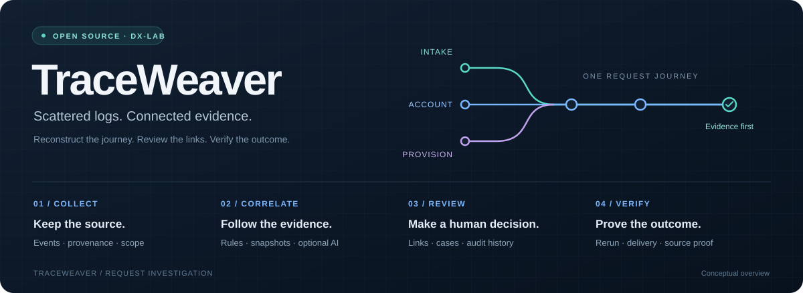
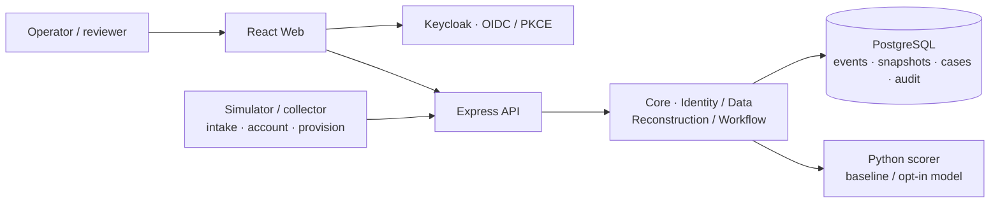
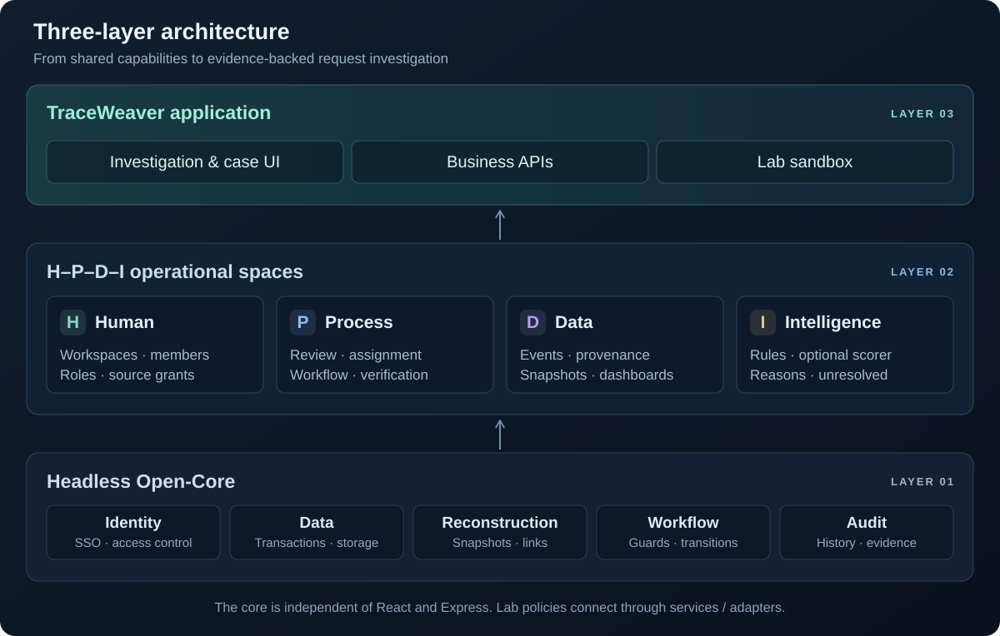

# TraceWeaver (Open Source Software Competition Entry 2026)

<p align="center">
  
</p>

<p align="center"><strong>From scattered logs to evidence-backed request journeys.</strong></p>

<p align="center">
  <a href="./LICENSE"></a>
  <a href="https://github.com/HaUI-HIT-Tam-Thai-T/TraceWeaver/actions/workflows/ci.yml"></a>
  
</p>

<div align="center">

[Open TraceWeaver](https://traceweaver.quizlearn.tech) &nbsp; · &nbsp; [Demo guide](docs/guides/demo.md) &nbsp; · &nbsp; [Installation](./INSTALL.md) &nbsp; · &nbsp; [API](https://api.quizlearn.tech/docs/) &nbsp; · &nbsp; [Documentation](./docs/README.md)

[Tiếng Việt](./README.md) · **English**

</div>

**Team:** HaUI.Tam_Thái_Tử

**Institution:** Trường Công nghệ Thông tin và Truyền thông, Đại học Công nghiệp Hà Nội

**Live application:** [traceweaver.quizlearn.tech](https://traceweaver.quizlearn.tech) · **Documentation:** [Guides and system design](./docs/README.md)

**Dự thi OLP Phần mềm nguồn mở 2026.** TraceWeaver connects evidence from multiple services into inspectable request journeys, supporting incident investigation and remediation verification. Its Identity, Data and Workflow core is reusable; the demonstration follows an IT operations scenario covering request intake, account creation and environment provisioning.

---

## 💡 Introduction

Each service records its own activity log. When a lab provisioning request fails, an operator may need to search several logs to find which step went wrong.

TraceWeaver brings related records into one request journey. For example, it can show that a request was received and its account was created, but allocating the lab machine failed because there was not enough RAM.

You can open a case, assign someone to investigate, record evidence and check the outcome after a repair. A simulated lab environment, called the sandbox, lets you try RAM, operating-system image and account failures without provisioning real resources.

To try the application, open the [hosted web app](https://traceweaver.quizlearn.tech) and use a [demo account](#pick-a-role-and-explore). You do not need development tools on your computer.

## ✨ Highlights

- Follow one request across several services without searching each log separately.
- Keep the original records, their sources and the history of review decisions.
- Leave links unresolved when records are missing or several explanations remain plausible.
- Use AI scores to help a reviewer assess links. The reviewer makes the decision; rules remain available when AI cannot be used.
- Repair a simulated condition, rerun the request and obtain new verification evidence before closing its case.
- Restrict access to the workspaces, roles and log sources granted to the user. A workspace is a group of members working with shared data.

## 🖥️ Interface

The React web app is organized by workspace, using Keycloak sessions and permissions supplied by the backend.

| Screen | Route | Purpose |
|---|---|---|
| Dashboard | `/dashboard` | Scoped statistics and navigation into cases |
| Events | `/events`, `/events/:eventId` | Search/filter logs, inspect provenance and start reconstruction |
| Cases | `/cases`, `/cases/:caseId` | Status, run/graph, review, evidence and sandbox operations |
| Knowledge | `/knowledge` | Workspace knowledge |
| Workspace administration | `/workspace-admin` | Membership, roles, source grants and configured account provisioning |

Session and API-client guidance is in [frontend/README.md](./frontend/README.md).
Follow [docs/guides/demo.md](docs/guides/demo.md) for a walkthrough with observable results.

## 🗺️ System architecture



The web app calls the API to search events, reconstruct journeys and manage cases.
The API validates identity/authorization, delegates business operations to the core and persists data in PostgreSQL.
The scorer receives authorized candidate pairs and cannot write the database or decide workflow actions.
Module responsibilities and data flows are described in [ARCHITECTURE.md](./ARCHITECTURE.md).

## 🧱 Three-layer architecture



The diagram shows how the shared processing layer supports the application. Its arrows connect architectural layers; they do not show individual network requests.

| Layer | Components |
|---|---|
| **1. Open-Core: shared processing, with no separate user interface** | Login and access permissions (Identity), reliable data storage (Data), saved request journeys and linking rules (Reconstruction), case steps and their conditions (Workflow), and action history (audit) |
| **2. H-P-D-I** | Four groups of functions: people (Human), procedures (Process), records (Data) and analysis support (Intelligence), using shared processing capabilities |
| **3. Application** | **TraceWeaver** — investigation and case-management web app, business APIs and lab-provisioning sandbox |

| Space | Investigation and case handling | Sandbox and verification |
|---|---|---|
| **H — Human** | Workspaces, members, roles and per-source read grants; knowledge for operators | Operators investigate, admins repair conditions, reviewers verify and decide closure within their permissions |
| **P — Process** | Create runs, review links, assign cases, add evidence and follow guarded transitions | Repair conditions → rerun request → deliver logs → verify source evidence → close when guards pass |
| **D — Data** | Multi-source events, provenance, journey snapshots, history/audit and dashboards | RAM/image/account state, execution attempts, log delivery and retained source proofs |
| **I — Intelligence** | Reconstruction rules and scoring for eligible pairs; preserve unresolved cases when evidence is insufficient | Compare execution outcomes and source evidence against current conditions; AI scores do not replace proof |

See the [architecture details](./ARCHITECTURE.md) and [core boundaries](./backend/src/core/README.md).

## 🧩 Features

**Collection and investigation:** batch ingestion, duplicate/conflict handling, source/time filters, provenance, versioned run snapshots, journey graphs, ID/order/outcome guards, unresolved events, link review and manual links.

**Cases and operations:** assignment, evidence, role/version-checked transitions, history/audit, dashboards, knowledge and membership/source-grant administration.

**Sandbox and AI:** RAM/image/account failure simulation, condition repair, request reruns, log delivery and immutable proof; baseline or opt-in sandbox-v2 scoring with fallback.

Feature integration and evidence are mapped in [FEATURE_STATUS](docs/overview/features.md); deployment history is recorded in [CURRENT_STATUS](docs/overview/status.md).
The sandbox-v2 model is experimental on synthetic data; its quality results and limits are documented in the [model card](./ai/artifacts/sandbox-v2/README.md).

## 🧰 Technology and licensing

| Component | Technology | License / inventory |
|---|---|---|
| Backend | Node.js 24, JavaScript ES modules, Express, JOSE | Project source Apache-2.0; [npm inventory](./backend/DEPENDENCIES.md) |
| Web | React, TypeScript, Vite, Tailwind, MUI, Radix UI | Project source Apache-2.0; [frontend inventory](./frontend/DEPENDENCIES.md) |
| AI service | Python, FastAPI, Pydantic, JSON model | Project source Apache-2.0; libraries under MIT, BSD, Apache-2.0, PSF; [Python inventory](./ai/DEPENDENCIES.md) |
| SSO | Keycloak | Apache-2.0; version/digest in the [runtime inventory](./backend/DEPENDENCIES.md#runtime-and-services) |
| Data | PostgreSQL 17 | PostgreSQL License |
| Simulator | Node.js, seeded synthetic generation | Project source Apache-2.0; [simulator](./simulator/README.md) |

Project source is licensed under [Apache-2.0](./LICENSE); third-party dependencies and assets retain their own terms.
Inventories, notices and distribution scope are documented in [LICENSES.md](./LICENSES.md); CycloneDX SBOMs are in [sbom/](./sbom/README.md).

## 🚀 Installation and startup

### 💻 Requirements

<details>
<summary>Tools and local ports</summary>

| Item | Requirement | Notes |
|---|---|---|
| Source | Git | Clone the repository |
| Backend / simulator | Node.js 24.14.1, npm 11.11.0 | Versions configured by the project |
| Database | PostgreSQL 17 | Docker Compose v2 or an external database |
| Web | Node/npm and a browser | Install dependencies separately in `frontend/` |
| Optional AI | Python and venv following [AI RUN](./ai/RUN.md) | Install the pinned requirements |
| Local ports | API 8080, PostgreSQL 55432, Keycloak 8081, web 5173 | Changes require consistent configuration |

</details>

### 📝 Steps

Run these commands in order to download the source, create server configuration, start PostgreSQL and create its tables:

```sh
git clone https://github.com/HaUI-HIT-Tam-Thai-T/TraceWeaver.git
cd TraceWeaver
npm ci
npm run db:setup                         # create .env if absent
docker compose -f compose.dev.yaml pull postgres  # if the image is not cached
npm run db:up
npm run db:migrate
npm run dev:be
```

Preserve existing credentials/configuration when `.env` already exists.
For an external database, set `DATABASE_URL` and skip the Docker PostgreSQL steps.
After these steps, the server can report its health. Signing in and accessing application data also require a login service and access permissions. Continue with **Fresh checkout/bootstrap** (setting up a new copy of the source) in [KEYCLOAK.md](./backend/KEYCLOAK.md).
Full installation guidance is in [INSTALL.md](./INSTALL.md).

```sh
npm run start:be                        # run without watch mode
npm run db:stop                         # stop DB, retain data
```

On PowerShell, use `npm.cmd` if execution policy blocks `npm.ps1`.

### 🛠️ Run and build individual components

Run these commands from the project directory containing `package.json`.

| Component | Preparation | Run / check |
|---|---|---|
| Backend | `npm ci`, DB/Identity configuration and migrations | `npm run dev:be` or `npm run start:be` |
| Web | `npm --prefix frontend ci`, create env from its example | `npm --prefix frontend run dev`; build with `npm --prefix frontend run build` |
| AI service | Create a venv and install `ai/requirements.txt` per [AI RUN](./ai/RUN.md) | Run `python -m ai.app` using the venv interpreter and valid scorer environment |
| Simulator | Node.js and configuration per the [simulator README](./simulator/README.md) | `npm run sim:generate` prints a manifest; specify `--out` to write a dataset |

Web development defaults to `http://localhost:5173`.
Create `frontend/.env.development.local` from [frontend/.env.example](./frontend/.env.example), then start Vite.
The current frontend requires HTTPS API and Identity endpoints; a local HTTP backend needs an appropriate HTTPS endpoint for web integration.
See [INSTALL.md](./INSTALL.md#4-frontend) for origins and callbacks.

### 🔧 Configuration

<details>
<summary>Environment variables</summary>

The backend uses the root `.env`; the web app uses Vite environment files.
Templates: [.env.example](./.env.example) and [frontend/.env.example](./frontend/.env.example).

| Variable | Purpose |
|---|---|
| `DATABASE_URL`, `POSTGRES_*` | PostgreSQL connection and credentials |
| `CURSOR_SECRET` | Random cursor key, at least 32 characters |
| `OIDC_ISSUER`, `OIDC_CLIENT_ID`, `OIDC_API_AUDIENCE` | Provider and API JWT validation |
| `FRONTEND_ORIGINS`, `FRONTEND_LOCAL_ORIGINS` | Exact allowed browser origins for the environment |
| `CORE_APP_CLIENT_ID`, `CORE_APP_SUBJECT` | Application identity for core workflow HTTP |
| `SCORER_URL`, `SCORER_SERVICE_SECRET`, `SCORER_MODEL_VERSION` | Backend scorer adapter and model opt-in |
| `LAB_INGEST_SUBJECT` | Sandbox log-collector service subject |
| `VITE_API_BASE_URL` | Web API HTTPS origin, without `/api/v1` |
| `VITE_KEYCLOAK_URL`, `VITE_KEYCLOAK_REALM`, `VITE_KEYCLOAK_CLIENT_ID` | Web public-client SSO settings |

Keep passwords, tokens and client secrets out of Git and `VITE_*` values.
Python scorer configuration and model opt-in are described in [SCORER.md](./backend/SCORER.md).

</details>

## 🌐 Try it

| Service | Address | Login / prerequisites |
|---|---|---|
| Live web app | [traceweaver.quizlearn.tech](https://traceweaver.quizlearn.tech) | Sign in with a demo account below |
| Development web app | [localhost:5173](http://localhost:5173) | Vite running; Keycloak login and workspace grants |
| Server Swagger | [api.quizlearn.tech/docs](https://api.quizlearn.tech/docs/) | Authorize according to the deployment |
| Local API | [127.0.0.1:8080](http://127.0.0.1:8080/health/live) | Public `/health/live` and `/health/ready`; business APIs require JWT/grants |
| Local Swagger | [localhost:8080/docs](http://localhost:8080/docs/) | **Authorize → keycloakLogin**, after bootstrap |
| Local Keycloak | [localhost:8081](http://localhost:8081) | Local bootstrap; credentials stored on your machine |

### Live deployment

The frontend is deployed at **[traceweaver.quizlearn.tech](https://traceweaver.quizlearn.tech)** and connects to the API and Keycloak at `api.quizlearn.tech`.
Nginx serves the static build over HTTPS, starts on boot and restarts automatically if its process stops. Certificate renewal is scheduled automatically.
Backend/scorer operations are documented in [deploy/oracle/README.md](./deploy/oracle/README.md).

<a id="pick-a-role-and-explore"></a>

### 🔑 Demo accounts

These four accounts work on the **live web app**. Shared demo password: **`Weave123!`**.
After signing in, select **TraceWeaver Sandbox — Mô phỏng kiểm chứng** to explore the role boundaries below.

| Username | Password | Sandbox role | What to try |
|---|---|---|---|
| `operator` | `Weave123!` | `operator` | Investigate logs, reconstruct journeys, work on cases and rerun requests |
| `reviewer` | `Weave123!` | `reviewer` | Review links, verify evidence and decide case closure |
| `viewer` | `Weave123!` | `viewer` | Inspect data and results without changing business state |
| `workspace-admin` | `Weave123!` | `admin` | Manage members/source access and repair simulation conditions |

A suggested session: investigate a failed request as `operator` → repair RAM/image/account conditions as `workspace-admin` → rerun as `operator` → verify and close as `reviewer` once all requirements are met.
Follow the [guided demo](docs/guides/demo.md) for the steps. Sign out before switching accounts.

Permissions belong to each workspace, not the username: in the **TraceWeaver** workspace, `viewer` currently also has `operator` and `reviewer` roles. Use **Sandbox** to try read-only access.
These are public demo accounts sharing mutable demo data; do not use them for real data.
`workspace-admin` has admin access in both demo workspaces: it can create accounts, change member roles/active status and grant/revoke source read access within its permitted scope. It cannot administer Keycloak/the server, delete SSO accounts or reset existing users' passwords. Only publish this credential for dedicated demo workspaces without real data.
Two additional server test accounts are outside this guided demo. Keycloak administration and service identities are also separate from web demo accounts.

**Running locally:** bootstrap still creates `demo.operator` and `demo.viewer` with random passwords in the Git-ignored `demo-credentials.local.json`.
Those accounts belong to your local environment; the live demo password above does not apply to them.

## 🔌 API

<details>
<summary>Authentication and API groups</summary>

- Local Swagger is at `/docs/`; shared contracts are in [backend/contracts/openapi.json](./backend/contracts/openapi.json) and [JSON Schemas](./backend/contracts/README.md).
- User APIs use `Authorization: Bearer <access token>`; ingestion and core workflow have separate service identities.
- Backend enforces current roles/source grants; a valid token does not grant access to every workspace.
- Versioned/idempotent operations follow their contracts; errors include a code and request ID for investigation.

| Group | Paths / documentation |
|---|---|
| Identity and sources | `GET /api/v1/me`, `/api/v1/workspaces/{wid}/sources`; [Identity](./backend/IDENTITY.md) |
| Events and ingestion | `/api/v1/workspaces/{wid}/events`, `/sources/{sid}/events:batch`; [Ingestion](./backend/INGESTION.md), [Events](./backend/EVENTS.md) |
| Runs and review | `/api/v1/workspaces/{wid}/runs`; [Reconstruction](./backend/RECONSTRUCTION.md) |
| Cases and workflow | `/api/v1/workspaces/{wid}/cases`; [Cases](./backend/CASES.md), [Core workflow](./backend/WORKFLOW.md) |
| Sandbox and proof | [LAB_SANDBOX.md](./backend/LAB_SANDBOX.md) |
| Dashboard and administration | [Dashboard](./backend/DASHBOARD.md), [Workspace admin](./backend/WORKSPACE_ADMIN.md) |
| AI scorer | Backend-only internal API; [SCORER.md](./backend/SCORER.md) |

</details>

## 🧪 Testing

- Backend unit/HTTP/contracts: `npm test`; contracts alone: `npm run test:contracts`.
- PostgreSQL: `npm run test:db`; Identity/HTTP/DB: `npm run test:identity:native`.
- Web: `npm --prefix frontend test`, `npm --prefix frontend run lint`, `npm --prefix frontend run build`.
- Simulator: `npm run test:sim`; AI: `python -m unittest discover -s ai/tests` in the venv.
- Licensing and structure: `npm run check:base`, `npm run licenses:check`, `npm run licenses:frontend:check`.
- SBOM: `npm run sbom:check`; Python license/SBOM: `python -m ai.scripts.dependency_inventory --check` in the venv.

Prerequisites, unit/integration/UAT boundaries and evidence limits are in [TESTING.md](./TESTING.md).
Feature coverage is mapped in [FEATURE_STATUS](docs/overview/features.md); inspect [Actions](https://github.com/HaUI-HIT-Tam-Thai-T/TraceWeaver/actions) for results on a specific commit.
The frontend SBOM omits optional dependencies; the Python SBOM is a flat inventory — see [SBOM scope](./sbom/README.md).

## 🐛 Troubleshooting

| Symptom | Check |
|---|---|
| PowerShell blocks `npm.ps1` | Use `npm.cmd` |
| API readiness returns 503 | Check DB, `DATABASE_URL` and migrations; see [Docker guide](./backend/DOCKER.md) |
| Login/callback fails | Check issuer, public client, exact origin and `/auth/callback`; see [Keycloak](./backend/KEYCLOAK.md) |
| Web cannot call API | API base must be an HTTPS origin; check env and CORS for localhost:5173 |
| Old run/case cannot be read | Check current membership and grants for every snapshot source |
| Hybrid is degraded | Check scorer URL, credentials, readiness and opt-in version |
| Repaired sandbox case cannot close | Check request rerun, log delivery and current source-proof validity |
| Inventory/SBOM is stale | Regenerate using [LICENSES](./LICENSES.md) and [SBOM](./sbom/README.md) guidance |

Support and safe diagnostic reporting are described in [SUPPORT.md](./SUPPORT.md).

## 📁 Repository structure

<details>
<summary>Directories and documentation</summary>

| Directory | Contents |
|---|---|
| [`backend/`](./backend/README.md) | Express API, headless core, migrations, contracts and tests |
| [`frontend/`](./frontend/README.md) | React web app, SSO, screens and tests |
| [`ai/`](./ai/README.md) | Scorer, features, versioned model, provenance and tests |
| [`simulator/`](./simulator/README.md) | Stateful business simulation and seeded log generation |
| [`deploy/oracle/`](./deploy/oracle/README.md) | Server deployment and operations |
| [`docs/`](./docs/README.md) | Overview, guides, reference, integration, competition and archives |
| [`sbom/`](./sbom/README.md) | CycloneDX JSON and regeneration instructions |
| [`.github/`](./.github/) | CI, dependency checks and issue/PR templates |

Core documents: [ARCHITECTURE](./ARCHITECTURE.md) · [INSTALL](./INSTALL.md) · [CHANGELOG](./CHANGELOG.md) · [LICENSES](./LICENSES.md).
Prepare source/distribution packages using [RELEASING](docs/guides/release.md).
The `v0.1.0-base.1` tag is an earlier scaffold; current scope is revision-specific in [CURRENT_STATUS](docs/overview/status.md).

</details>

## 🤝 Contributing

- **Report a bug:** [open a bug report](https://github.com/HaUI-HIT-Tam-Thai-T/TraceWeaver/issues/new?template=bug_report.md) with revision and reproduction steps.
- **Suggest a feature:** [open a feature request](https://github.com/HaUI-HIT-Tam-Thai-T/TraceWeaver/issues/new?template=feature_request.md).
- **Submit code:** read [CONTRIBUTING.md](./CONTRIBUTING.md) and follow [CODE_OF_CONDUCT.md](./CODE_OF_CONDUCT.md).
- **Sensitive issues:** follow [SECURITY.md](./SECURITY.md); use synthetic data and remove secrets from public logs/screenshots.

## Talk to the TraceWeaver developers

Reach a team member directly:

- **Nguyễn Văn Phước** — [vanphuocken@gmail.com](mailto:vanphuocken@gmail.com)
- **Trần Xuân Khương** — [tranxuankhuong24022006@gmail.com](mailto:tranxuankhuong24022006@gmail.com)
- **Phạm Thiên Bảo** — [thienbaomk147@gmail.com](mailto:thienbaomk147@gmail.com)

For reproducible bugs and feature suggestions, open a [GitHub Issue](https://github.com/HaUI-HIT-Tam-Thai-T/TraceWeaver/issues) so the discussion can be tracked.

## 📜 License

Apache License 2.0; see [LICENSE](./LICENSE) and [NOTICE](./NOTICE).
Dependency, model and dataset provenance/scope are documented in [LICENSES.md](./LICENSES.md) and the [model card](./ai/artifacts/sandbox-v2/README.md).
