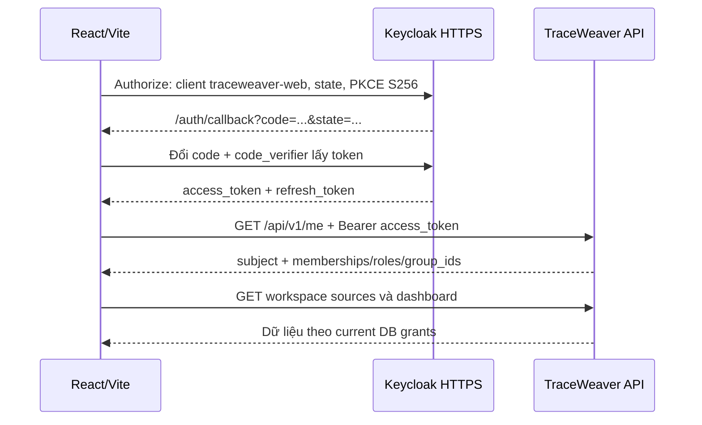
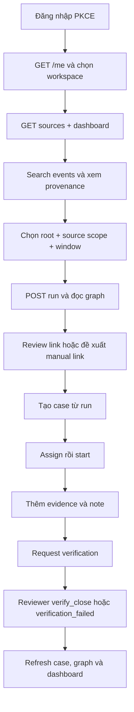
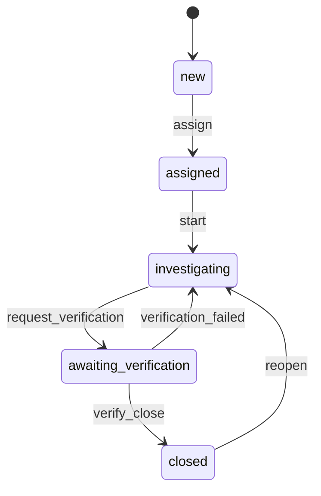

# Bàn giao Frontend — TraceWeaver

> Bổ sung 29/10/2026: [Knowledge, tên workspace/nguồn và danh sách người nhận hồ sơ](FRONTEND_READABLE_DATA_HANDOFF.md). Xem trạng thái rollout trong bản bổ sung trước khi dùng API mới.

Cập nhật 27/10/2026, theo source và API Oracle tại commit `116e156`. FE dùng **React/Vite**, local **http://localhost:5173**, production dự kiến **https://traceweaver.quizlearn.tech**. Trạng thái cấu hình đang chạy và các bước còn thiếu được ghi ở mục 2.

Đọc tài liệu này để triển khai luồng; tra từng endpoint, field, enum và ví dụ JSON tại [API reference](FRONTEND_API_REFERENCE.md). [OpenAPI](../backend/contracts/openapi.json) và [JSON Schema](../backend/contracts/schemas/domain.schema.json) là hợp đồng chuẩn. Ví dụ trong tài liệu là dữ liệu minh họa, không phải ID/token/response production để sao chép nguyên vào request.

## 1. Thông tin kết nối và phạm vi

| Mục | Giá trị |
|---|---|
| API origin | `https://api.quizlearn.tech` |
| API prefix | `/api/v1` |
| Swagger | https://api.quizlearn.tech/docs/ |
| OpenAPI có OAuth production | https://api.quizlearn.tech/docs/openapi.json |
| JSON Schema | https://api.quizlearn.tech/docs/schemas/domain.schema.json |
| Liveness / readiness | `/health/live` / `/health/ready` |
| Keycloak base URL | `https://api.quizlearn.tech/identity` |
| Realm | `traceweaver` |
| OIDC issuer | `https://api.quizlearn.tech/identity/realms/traceweaver` |
| Discovery | https://api.quizlearn.tech/identity/realms/traceweaver/.well-known/openid-configuration |
| Public client ID | `traceweaver-web` |
| Access-token audience | `traceweaver-api` |
| Flow | Authorization Code + PKCE S256; access JWT Bearer |

Có **16 operation cho browser**, **1 ingest**, **3 core workflow** đã implement. Scorer là operation thứ 21, **planned**; hai health operation có contract riêng. FE gọi 16 API user và health; ingest/core do server/producer dùng. Hybrid hiện trả kết quả rule với trạng thái degraded, chưa có model chạy trong deployment này.

`operator` và `viewer` là hai tài khoản ứng dụng được tạo trên Oracle. Mật khẩu bàn giao riêng, không đưa vào tài liệu, source hoặc biến `VITE_*`. `oracle-admin` thuộc realm `master` để quản trị Keycloak, không phải admin nghiệp vụ và không dùng đăng nhập FE. Hiện chưa có user mang role `reviewer` hoặc `admin` trong ứng dụng; kịch bản verify/close/reopen cần BE provision reviewer cùng membership/read grants trước khi UAT.

Client `traceweaver-ingest` và `traceweaver-core` dùng secret phía server. FE không được nhận hoặc dùng hai secret này để giả lập quyền người dùng. Backend không có endpoint nhận username/password để login, không có `/api/v1/auth/login` và không nhận ID token thay access token.

## 2. Những việc cần hoàn tất trước khi nối FE vào Oracle

Ngày 27/10/2026 đã bổ sung trực tiếp trên Keycloak Oracle, realm `traceweaver`, client `traceweaver-web`: **Valid Redirect URIs** `http://localhost:5173/auth/callback`, **Web Origins** `http://localhost:5173`, **Valid Post Logout Redirect URIs** `http://localhost:5173`. Callback local trước sửa trả400 `Invalid parameter: redirect_uri`, sau sửa trả200 với form đăng nhập; token preflight cho origin local trả200; logout chưa có phiên trả302 đúng URL local. Callback Swagger vẫn trả200 và URI ngoài allowlist vẫn bị từ chối. Chưa kiểm toàn bộ đăng nhập/đổi code từ FE.

API CORS production chưa đổi: local vẫn dùng Vite proxy ở mục 2.2. `127.0.0.1:5173` và domain FE chưa được đăng ký; DNS frontend chưa xác nhận, frontend chưa deploy. File realm import trên server chưa đồng bộ thay đổi này; cấu hình live được lưu trong database Keycloak và giữ qua restart với database hiện tại. Khi dựng realm mới cần áp dụng lại cấu hình. Checklist dưới đây vẫn áp dụng cho phần còn thiếu.

### 2.1. Cấu hình do BE/vận hành thực hiện

1. Thêm `https://traceweaver.quizlearn.tech` vào `FRONTEND_ORIGINS`, giữ origin Swagger hiện tại:

   ```dotenv
   FRONTEND_ORIGINS=https://api.quizlearn.tech,https://traceweaver.quizlearn.tech
   ```

2. Trong realm `traceweaver`, client `traceweaver-web`, bổ sung **Valid Redirect URIs** chính xác:

   ```text
   https://traceweaver.quizlearn.tech/auth/callback
   http://localhost:5173/auth/callback
   http://127.0.0.1:5173/auth/callback
   ```

3. Bổ sung **Web Origins** cho ba origin FE tương ứng; giữ origin/callback Swagger cũ. Khai báo **Valid Post Logout Redirect URIs** cho URL gốc của từng FE nếu dùng logout redirect ở mục 3. Không dùng wildcard thay cho danh sách này.
4. Recreate riêng container API sau khi đổi environment; sửa client Keycloak qua Admin API/console có hiệu lực ngay. Chỉ sửa file realm import không cập nhật realm đã tồn tại trong database.
5. Trỏ DNS frontend, cấp TLS và cấu hình hosting SPA trả `index.html` cho `/auth/callback` và route React khi reload. Vite build cần deployment static riêng; API domain đã có Nginx/TLS không đồng nghĩa frontend domain đã có.
6. Provision reviewer trước khi kiểm đóng/mở lại case; chuẩn bị dữ liệu event qua producer/ingest. FE không tự ingest bằng secret trong browser.

Backend `APP_ENV=production` chỉ chấp nhận **HTTPS origins** trong `FRONTEND_ORIGINS`. Vì thế không thêm `http://localhost:5173` vào biến production: API có thể không khởi động. Local dùng Vite proxy cho API; Keycloak vẫn cần callback/Web Origins local để đổi code lấy token.

### 2.2. Cấu hình React/Vite local

Ví dụ `vite.config.ts` dành riêng cho development, ghép vào config đang có:

```ts
import { defineConfig } from 'vite';
import react from '@vitejs/plugin-react';

export default defineConfig({
  plugins: [react()],
  server: {
    host: 'localhost',
    port: 5173,
    strictPort: true,
    proxy: {
      '/api': {
        target: 'https://api.quizlearn.tech',
        changeOrigin: true,
        secure: true,
        configure(proxy) {
          proxy.on('proxyReq', (proxyReq) => {
            proxyReq.removeHeader('origin');
          });
        },
      },
    },
  },
});
```

Browser gọi `/api/v1/...` cùng origin Vite; Vite chuyển nguyên path và Bearer token tới API qua HTTPS. Header Origin local được bỏ ở proxy development vì request browser→Vite là same-origin, còn chặng Vite→BE là server→server. JWT và kiểm quyền trên BE vẫn bắt buộc. Không mở Vite proxy công khai, không đặt `secure:false`, không strip `/api` khỏi path. Không proxy `/core` hoặc chuyển service secret vào FE.

OAuth dùng URL Keycloak HTTPS thật, không proxy `/identity` thành issuer local. Điều này giữ `iss` đúng như backend yêu cầu. Tra proxy options tại [Vite](https://vite.dev/config/server-options#server-proxy).

```dotenv
# FE .env.development — đều là cấu hình công khai
VITE_API_BASE_URL=
VITE_KEYCLOAK_URL=https://api.quizlearn.tech/identity
VITE_KEYCLOAK_REALM=traceweaver
VITE_KEYCLOAK_CLIENT_ID=traceweaver-web
```

```dotenv
# FE .env.production
VITE_API_BASE_URL=https://api.quizlearn.tech
VITE_KEYCLOAK_URL=https://api.quizlearn.tech/identity
VITE_KEYCLOAK_REALM=traceweaver
VITE_KEYCLOAK_CLIENT_ID=traceweaver-web
```

Vite đưa `VITE_*` vào bundle. Không thêm mật khẩu, DB URI, cursor key hoặc client secret. `server.proxy` chỉ chạy khi dev; build production gọi API origin thật và cần CORS ở mục 2.1. `strictPort` tránh Vite tự chuyển 5174 làm sai callback đã đăng ký.

## 3. Luồng xác thực và khởi động React



FE nên dùng `keycloak-js` và khóa phiên bản tương thích trong lockfile FE. Cài package trong project FE khi triển khai; tài liệu này không thêm dependency vào workspace backend. Các API adapter dựa trên [tài liệu Keycloak](https://www.keycloak.org/securing-apps/javascript-adapter).

Ví dụ module singleton `auth.ts`:

```ts
import Keycloak from 'keycloak-js';

export const keycloak = new Keycloak({
  url: import.meta.env.VITE_KEYCLOAK_URL,
  realm: import.meta.env.VITE_KEYCLOAK_REALM,
  clientId: import.meta.env.VITE_KEYCLOAK_CLIENT_ID,
});

const callback = `${window.location.origin}/auth/callback`;
let initialization: Promise<boolean> | undefined;

export function initializeAuth() {
  return initialization ??= keycloak.init({
    pkceMethod: 'S256',
    responseMode: 'query',
    checkLoginIframe: false,
    redirectUri: callback,
  });
}

export const signIn = () => keycloak.login({ redirectUri: callback });
// Chỉ dùng sau khi BE đăng ký post-logout redirect URL gốc.
export const signOut = () => keycloak.logout({
  redirectUri: window.location.origin,
});
```

Gọi và `await initializeAuth()` **một lần trước khi mount Router/React root**. Nếu trả false, hiển thị nút đăng nhập; nếu true, gọi `/me`. Không gọi `init()` lại trong mỗi render hoặc effect bị StrictMode chạy lại. Router cần route `/auth/callback`; adapter xử lý code/state trước Router. Không tự lưu/đổi code lần thứ hai.

`state`, PKCE verifier và refresh do adapter quản lý; access/refresh token giữ trong memory. Không persist token trong localStorage, sessionStorage, query cache được lưu đĩa hoặc URL ứng dụng. Trước request, gọi `updateToken(30)`; refresh thất bại thì xóa trạng thái/cache phiên và yêu cầu login lại. Với `checkLoginIframe:false`, FE không nhận thông báo logout liên tab theo iframe; lần refresh/API sau mới thể hiện phiên hết hiệu lực. Backend xác minh JWT cục bộ, không introspect logout: token còn hạn có thể tiếp tục hợp lệ đến expiry, trong khi thu hồi membership/grants có hiệu lực ở request tiếp theo.

Sau `/me`:

- Không có membership: màn hình “Tài khoản chưa được cấp workspace”; dừng gọi API workspace.
- Có một membership: chọn workspace đó; có nhiều thì cho chọn, không lấy ID cố định trong code.
- Quyền lấy từ `memberships[].roles` của workspace đang chọn, không từ role claims tự decode trong JWT.
- Source picker lấy `/sources`. Admin không tự có read grant. Đổi workspace/đăng xuất/mất quyền phải xóa cache và lựa chọn cũ.

## 4. API client và quy ước chung

Request dùng `Authorization: Bearer <access_token>`; POST thêm `Content-Type: application/json`. Không dùng ID token hoặc Basic Auth, không gửi `X-Actor-Subject`. Các body đóng field: không tự thêm `subject`, `state`, `version`, `workspace_id` vào request chưa có field đó. Query trống, lạ hoặc lặp có thể trả 400; bỏ hẳn filter chưa chọn.

Ví dụ khung client TypeScript; phần `ApiError` và thông báo UI có thể ghép với ứng dụng FE:

```ts
import { keycloak } from './auth';

const base = (import.meta.env.VITE_API_BASE_URL ?? '').replace(/\/$/, '');
export class ApiError extends Error {
  constructor(
    public status: number,
    public code: string,
    public requestId: string | null,
  ) { super(code); }
}

export async function api<T>(path: string, options: {
  method?: 'GET' | 'POST'; body?: unknown;
  idempotencyKey?: string; signal?: AbortSignal;
} = {}): Promise<T> {
  if (!path.startsWith('/api/v1/')) throw new Error('Unsupported API path');
  await keycloak.updateToken(30);
  if (!keycloak.token) throw new Error('Authentication required');
  const headers = new Headers({ Authorization: `Bearer ${keycloak.token}` });
  if (options.body !== undefined) headers.set('Content-Type', 'application/json');
  if (options.idempotencyKey) headers.set('Idempotency-Key', options.idempotencyKey);
  const response = await fetch(base + path, {
    method: options.method ?? 'GET', headers, signal: options.signal,
    body: options.body === undefined ? undefined : JSON.stringify(options.body),
    credentials: 'omit',
  });
  const payload = response.headers.get('content-type')?.includes('json')
    ? await response.json() : null;
  if (!response.ok) throw new ApiError(
    response.status, payload?.error?.code ?? `HTTP_${response.status}`,
    payload?.request_id ?? response.headers.get('X-Request-ID'),
  );
  return payload as T;
}
```

Đây là khung tích hợp, không thay runtime response validation và thiết kế màn hình lỗi của FE. Không tự retry POST trong wrapper. Proxy/Nginx có thể trả HTML cho 413/502/504; code trên vẫn giữ HTTP status để UI xử lý thay vì lỗi `JSON.parse`. `AbortSignal` chỉ hủy chờ phía FE, không chứng minh server rollback; xem quy tắc retry ở mục 8.

### 4.1. JSON, thời gian và các ID

- Không có envelope `data`: `/me` trả trực tiếp `Me`, `/runs` trả `Run`, `/cases/{cid}` trả `{case,history,evidence}`.
- Dùng đúng field: Event là `event_id`; Source/Run/Link/Case là `id`. `owner_id` là **subject Identity**, không phải email, username hoặc UUID workspace.
- API dùng timestamp UTC kết thúc `Z`. Date picker theo Asia/Ho_Chi_Minh cần chuyển sang UTC khi tạo filter. Giữ nguyên chuỗi timestamp event khi hiển thị/ghi nhận provenance; `Date` JavaScript chỉ giữ milliseconds, có thể mất microseconds nếu serialize lại dữ liệu đã nhận.
- Không đổi `null` thành `0` hoặc chuỗi rỗng: `score:null`, `owner_id:null`, `model_version:null`, `next_cursor:null` có ý nghĩa riêng.
- Dữ liệu `message`, `note`, `reason`, article body và payload là nội dung cần escape khi render. Không chèn thẳng bằng `dangerouslySetInnerHTML`.

### 4.2. Phân trang

Nguồn, tri thức, events và cases trả `{items,next_cursor}`; default `limit=50`, max100. Không có page number, offset, total count hoặc tổng số trang trong DTO.

Cursor là opaque string: giữ nguyên, URL-encode bằng `URLSearchParams`, lặp lại filter và limit khi lấy trang sau. Đổi workspace/filter/limit/quyền thì reset cursor. FE có thể giữ stack cursor của từng trang để quay lại; không tự giải mã cursor hoặc tạo cursor từ ID cuối.

Events có snapshot cố định: event mới không xuất hiện giữa các trang; nhấn refresh để bắt đầu snapshot mới. Cases phân trang theo **trạng thái hiện tại**, có thể thay đổi khi người khác chuyển trạng thái; không gán bảo đảm snapshot events cho case list. Sources/knowledge cũng không có bảo đảm snapshot events.

## 5. Luồng màn hình và API



| Màn hình/thao tác | API hoặc dữ liệu | Trạng thái UI cần có |
|---|---|---|
| Chọn workspace | `GET /api/v1/me` | Chưa login, chưa có membership, chọn workspace |
| Dashboard | `GET /workspaces/{wid}/dashboard` | Loading, số 0, lỗi, filter thời gian |
| Source picker | `GET /workspaces/{wid}/sources` | Chỉ nguồn được đọc, không tự thêm nguồn ẩn |
| Event explorer/detail | `GET /events`, `GET /events/{eid}` | Empty, pagination, quyền bị thu hồi, provenance |
| Tạo reconstruction | `POST /runs` | Window quá lớn, sending, response completed/degraded |
| Graph | `GET /runs/{rid}`, `GET /runs/{rid}/graph` | Pending/accepted/rejected, unresolved, missing steps |
| Review/manual link | `POST .../reviews`, `POST .../links` | Reason/version, conflict, closed-case lock |
| Danh sách/chi tiết case | `GET /cases`, `GET /cases/{cid}` | State/owner filter, history, evidence |
| Thao tác case | `POST /cases`, `POST .../evidence`, `POST .../transitions` | Role/owner guards, conflict, khóa nút đang gửi |
| Knowledge | `GET /knowledge?q=...` | Chỉ đọc, latest version, source_ref URI |

Các path rút gọn trong bảng đều có prefix `/api/v1/workspaces/{wid}`. Danh sách đầy đủ và field request/response nằm trong [API reference](FRONTEND_API_REFERENCE.md).

### 5.1. Events → Run → Graph

1. Tải sources và events theo source/time/action/q. Bắt đầu với window nhỏ; backend chưa cung cấp total count để dự đoán số event trong run.
2. Chọn `root_event_id` từ Event đã xem. `source_ids` phải chứa nguồn root, mọi nguồn phải có read grant; `window` phải chứa root.
3. `POST /runs` với `mode=rule_only` hoặc `hybrid`, và một Idempotency-Key cho thao tác. Window tối đa **1 giờ**, snapshot tối đa **1.000 events trước khi lọc action/candidate**. Vượt giới hạn: 422 `WINDOW_TOO_LARGE`, thu hẹp thời gian/nguồn; backend không tự cắt dữ liệu.
4. Backend hiện thực thi trong transaction và trả **202 với Run đã completed**. Không bắt buộc hiện spinner queued trong nhiều giây chỉ vì status HTTP là 202. Contract vẫn có queued/running/failed: nếu gặp queued/running, GET URL trong Location theo backoff; nếu failed, hiển thị `Run.error` và dừng poll. Không coi kiến trúc hiện tại là background worker.
5. Khi completed, GET graph. Sau mọi review/manual link, refetch graph; đừng chỉ sửa nét cạnh ở client vì version/unresolved/missing steps có thể cùng thay đổi.

Policy hiện tại: `intake/request.accepted → account/account.created → provision/provision.completed|provision.failed`, namespace mạnh `request`, `account`, `job`. Cùng actor/thời gian gần hoặc cùng journey không đủ để tự nối. Không có transition tự bỏ qua account. Source/action chưa hỗ trợ có thể vẫn là node nhưng unresolved.

Quy ước graph:

| Field/trạng thái | Cách hiểu và hiển thị |
|---|---|
| `nodes` | Toàn bộ snapshot; dùng `event_id` làm key |
| `links` | Cạnh có hướng; root có thể ở giữa/cuối hành trình |
| `method` | rule/model/manual; không suy method từ score |
| `score:null` | Không có điểm số; không hiện 0% hoặc “AI tin cậy” |
| `review_state=pending` | Đề xuất chưa xác nhận; trạng thái ban đầu của rule/manual |
| accepted / rejected | Quyết định người duyệt, không phải nhãn model tự sinh |
| `unresolved_event_ids` | Node chưa nối vào root component, không khẳng định là cùng journey |
| `missing_expected_steps` | Hiển thị nguyên nghĩa “chưa có bằng chứng”; không kết luận bước thất bại |
| `Graph.version` | Revision toàn graph; không gửi thay Link.version |
| `Link.version` | Gửi làm expected_version khi review đúng link |

Pending và accepted tham gia connectivity, rejected không tham gia; rejected vẫn có thể được trả trong links. Baseline ban đầu giữ các đề xuất trong root component; sau review/manual, các cạnh được lưu vẫn được chiếu lại theo review mới nhất. Snapshot events không đổi khi có event mới hoặc review mới. Muốn đưa event đến muộn vào điều tra phải tạo run mới.

`hybrid` hiện luôn có `degraded=true`, `degraded_reason=ai_unavailable`, `effective_method=rule_only`, `model_version=null`. UI vẫn hiển thị graph kèm thông báo “AI chưa sẵn sàng, kết quả dùng luật”; không đánh dấu run failed chỉ vì degraded.

### 5.2. Review và manual link

Review body: `decision` chỉ accepted/rejected; reason không trắng, tối đa1.000; `expected_version` lấy từ **link hiện đang hiển thị**. Thành công trả Review với `link_version` mới. Kể cả cùng decision cũ vẫn thêm history/version. Không có DELETE link hoặc PATCH state.

Manual body gồm `from_event_id`, `to_event_id`, `reason`. Hai event phải thuộc cùng snapshot; response là Link `manual/pending`, score null, version1. Cạnh trùng trả409 `LINK_EXISTS` kể cả cạnh cũ rejected; muốn đổi quyết định dùng review. Self-link/cycle trả422. Manual link vẫn cần review trước khi đóng case.

Hai API này không có idempotency contract. Không tự gửi lại sau timeout: GET graph để xem thao tác đã được commit hay chưa. Mọi graph mutation đều bị chặn bằng409 `CASE_CLOSED` nếu có **bất kỳ** case closed trên run đó. Mở lại một case chưa đủ nếu run còn case closed khác.

### 5.3. Case và quy trình xử lý



Create case từ run completed: `{run_id,title}`. Case bắt đầu `new`, owner null, version1. Chi tiết trả **`{case,history,evidence}`**; state/owner/version do workflow cung cấp. Mọi transition cần `action`, `expected_version=case.version`, `reason`; `owner_id` chỉ gửi khi assign.

| Action | Từ → đến | Ai được gọi | Điều kiện thêm |
|---|---|---|---|
| assign | new → assigned | operator/reviewer | Owner là subject có membership, operator/reviewer và đủ grants mọi nguồn run |
| start | assigned → investigating | Operator đang là owner hoặc reviewer | Owner còn hợp lệ |
| request_verification | investigating → awaiting_verification | Operator đang là owner hoặc reviewer | Owner hợp lệ, ít nhất1 evidence, có note xử lý không trắng |
| verify_close | awaiting_verification → closed | reviewer | Owner/note/evidence hợp lệ và **không còn link pending trên toàn run** |
| verification_failed | awaiting_verification → investigating | reviewer | Owner còn hợp lệ; giữ owner |
| reopen | closed → investigating | reviewer | Owner hợp lệ, reason khác lần close gần nhất |

Role `admin` **một mình** không được ghi; cần operator/reviewer bổ sung. Viewer chỉ đọc. Membership/role trong bảng là theo workspace và luôn cần full read grants trên mọi nguồn của run, kể cả nguồn rỗng. FE chỉ ẩn/hiện nút hỗ trợ UX; BE kiểm lại mọi request. DTO không trả `allowed_actions`/guard facts, nên FE không thể chắc chắn nút sẽ thành công chỉ từ case.state.

Chưa có API liệt kê thành viên để tạo owner picker. Với operator có đủ nguồn, có thể chọn “Giao cho tôi” bằng `/me.subject`; không tự gửi username `operator` làm owner_id. Picker nhiều người cần danh sách subject đã được BE bàn giao riêng hoặc một API bổ sung được thống nhất.

Evidence:

- `kind=events`: `event_ids` không rỗng, thuộc snapshot của case.run; `note` vẫn là field bắt buộc nhưng có thể rỗng.
- `kind=note`: note không trắng; vẫn gửi `event_ids`, có thể `[]`.
- Note tối đa10.000 ký tự, event refs tối đa1.000 theo runtime; tất cả ghi nhận append-only. Chưa có sửa/xóa evidence.
- Thêm evidence **không tăng Case.version**; phải refetch detail để cập nhật evidence, không tự tăng version ở FE.
- Evidence đóng case bị khóa409. Note-only evidence hợp lệ không đồng nghĩa có bằng chứng event hoặc provisioning thành công.

Để request verification, thêm một note xử lý hoặc evidence có note không trắng; reason của transition không tự thay handling note đã lưu. Khi close, backend chụp căn cứ và đóng băng chỉnh graph của toàn run. Nếu owner đã mất quyền, reopen có thể bị chặn cho đến khi BE khôi phục quyền owner; chưa có reassignment sau trạng thái new.

### 5.4. Dashboard và drill-down

| Counter | Ý nghĩa |
|---|---|
| runs | Run nhìn thấy được trong time filter |
| degraded_runs | Những run trên có degraded |
| unresolved_events | Event occurrences chưa nối vào root component, cộng theo từng run completed |
| waiting_cases | Case state new hoặc assigned thuộc các run trong filter |

Filter `from`/`to` của dashboard và list cases cùng áp lên **run.created_at**, không phải occurred_at của event, ngày tạo case hoặc ngày chuyển trạng thái. `unresolved_events` không phải số event duy nhất toàn hệ thống; cùng event trong hai run có thể đếm hai lần.

Drill-down waiting: gọi list cases hai lần, `state=new` và `state=assigned`, cùng from/to; query `state=new&state=assigned` hoặc `state=new,assigned` không được hỗ trợ. Hai response có thể quan sát state tại hai thời điểm khác nhau. Không có endpoint danh sách run/global unresolved để nối thẳng mọi card dashboard sang một bảng run; chỉ có GET run/graph khi đã biết run ID. FE cần giữ run ID từ create hoặc case.run_id.

## 6. Ma trận quyền tối thiểu

| Nhóm thao tác | viewer | operator | reviewer | admin đơn thuần |
|---|---|---|---|---|
| /me | Có token đúng client | Có | Có | Có |
| Đọc sources/events/runs/graph/cases/dashboard | Có grants | Có grants | Có grants | Có grants |
| Đọc knowledge | Membership + role đọc | Có | Có | Có |
| Create run/review/manual/create case/add evidence | Không | Có grants | Có grants | Không |
| Assign case new | Không | Có | Có | Không |
| Start/request verification | Không | Phải là owner | Có | Không |
| Verify close/fail/reopen | Không | Không | Có | Không |
| Ingest batch | Không | Không | Không | Không |

Ingest cần đúng ingest client + membership + `ingest_service` + ingest grant. Read grant không thay ingest grant, ngược lại cũng vậy. User có nhiều role thì hợp quyền theo từng thao tác; bảng không có nghĩa role admin tự bao gồm role operator/reviewer. Người chưa có membership vẫn có thể login thành công nhưng không có workspace dữ liệu.

## 7. Xử lý lỗi và hiển thị trạng thái

Error body chuẩn:

<!-- schema:Error -->
```json
{"error":{"code":"VERSION_CONFLICT","message":"Workflow version has changed"},"request_id":"example-request-id"}
```

Lưu `request_id` cho thông báo hỗ trợ; response còn có `X-Request-ID`. Không log Authorization, token, secret hoặc nguyên payload nhạy cảm. `error.details` là field tùy chọn của schema, không bảo đảm backend trả chi tiết lỗi từng field.

| HTTP / code thường gặp | Hành vi FE |
|---|---|
| Network/timeout/abort | Giữ input; chưa biết POST đã commit chưa; xử lý theo mục 8 |
| 400 INVALID_QUERY / INVALID_CURSOR | Kiểm query, reset cursor khi đổi scope/filter; không retry vô hạn |
| 401 INVALID_TOKEN | Refresh hoặc login lại; không nhầm với lỗi quyền 403 |
| 403 FORBIDDEN | Cập nhật quyền UI, báo không được thao tác |
| 403 CORS_FORBIDDEN / browser CORS error | Kiểm origin/proxy và preflight; browser có thể không cho FE đọc error body |
| 404 NOT_FOUND | Không tồn tại hoặc bị ẩn vì mất scope; xóa cache artifact và rời màn hình phù hợp |
| 409 VERSION_CONFLICT | GET graph/case mới, giữ lý do draft, cho người dùng quyết định lại |
| 409 IDEMPOTENCY_CONFLICT | Key đã dùng với body khác; không tự đổi key để giấu lỗi |
| 409 LINK_EXISTS | Refetch graph và dùng link cũ/review thay vì tạo lại |
| 409 CASE_CLOSED | Báo run/case đang khóa; cần reviewer reopen theo guard |
| 409 RUN_NOT_READY | Chờ run completed; không đọc graph như thể thành công |
| 413 / 415 | Giảm kích thước; gửi JSON không nén và đúng media type |
| 422 INVALID_RUN_INPUT / INVALID_CASE_INPUT / GUARD_FAILED | Giữ form, chỉ ra điều kiện còn thiếu theo context; code thực tế theo reference/source |
| 422 WINDOW_TOO_LARGE | Thu hẹp window hoặc sources, không bỏ qua event ở FE |
| 422 SELF_LINK / LINK_CYCLE | Hủy đề xuất cạnh không hợp lệ |
| 429 | Tôn trọng Retry-After nếu có; chưa có bảo đảm rate limit runtime từ contract |
| 500 / 502 / 503 / 504 | Hiển thị service/proxy error và request_id nếu có; không kết luận AI degraded nếu chưa có Run.degraded |

Không suy rằng mọi status liệt kê trong OpenAPI đều xuất hiện ở mọi route: contract dùng chung tập lỗi; controller/media limit có thể thêm400/413/415. Backend error code và status là thứ dùng để phân nhánh, không so chuỗi message tiếng Anh.

## 8. Idempotency, version và cache

| POST | Retry an toàn |
|---|---|
| Create run, create case, transition case | Dùng cùng Idempotency-Key và **cùng body** trong24h |
| Review link | Không có key contract; sau timeout GET graph, kiểm version mới trước quyết định tiếp |
| Manual link | Sau timeout GET graph tìm pair; không blind retry |
| Add evidence | Không có key contract; sau timeout GET detail để kiểm đã thêm chưa |
| Ingest | Server producer dedup bằng source_event_id, không dùng browser |
| Core workflow | Không hỗ trợ Idempotency-Key; chỉ app server tích hợp |

Sinh key bằng `crypto.randomUUID()` **một lần cho mỗi thao tác người dùng**, giữ qua network retry. Chỉ tạo key mới khi người dùng chủ động bắt đầu thao tác mới. Key cùng actor/workspace/route có TTL24h; sau TTL hoặc đổi user không còn bảo đảm replay cũ. Nút submit đang gửi cần khóa để tránh hai request không key.

Replay có thể trả Case version cũ đã commit dù sau đó case đã chuyển tiếp: GET detail để lấy state hiện tại. Retry luôn bị kiểm quyền hiện tại. Version là cơ chế chống mất cập nhật, không thay idempotency. `Case.version`, `Link.version`, `Graph.version` độc lập; không cộng version ở client rồi gửi.

Gợi ý cache keys: gồm subject, workspace, endpoint và normalized filters; graph thêm runId, case thêm caseId. Sau review/manual refetch graph + dashboard. Sau transition refetch case detail + cases + dashboard, và graph nếu close/reopen. Sau add evidence refetch case detail. Khi logout/đổi user hoặc mất grant, purge cache nhạy cảm; `Cache-Control:no-store` không tự xóa state trong React Query/store.

## 9. Checklist nghiệm thu FE với BE

- [x] Keycloak live đã đăng ký callback/Web Origin/logout cho `http://localhost:5173` (27/10/2026).
- [ ] BE đã đăng ký CORS production, callback/Web Origins cho `127.0.0.1:5173` và domain production, đồng bộ realm import ở mục 2.
- [ ] Local Vite luôn ở5173; API đi proxy, OAuth dùng issuer HTTPS thật.
- [ ] Login cả operator/viewer, refresh, logout, reload `/auth/callback`, phiên hết hạn.
- [ ] `/me` empty memberships hiển thị đúng; không hardcode workspace hay subject.
- [ ] Viewer chỉ đọc, operator không thấy verify_close; reviewer riêng được provision để UAT kết thúc case.
- [ ] List sources/events/knowledge/cases xử lý empty, next_cursor null, filter thay đổi và cursor invalid.
- [ ] Đã có event thật qua producer; không nhầm fixtures schema thành dataset được ingest.
- [ ] Create rule_only/hybrid, 202 completed, degraded và window-too-large.
- [ ] Graph render directed links, null score, pending/accepted/rejected, unresolved, missing evidence.
- [ ] Review stale version409 và manual duplicate/cycle; refetch graph sau mutation.
- [ ] Create/assign/start/evidence/request verification; reviewer close/fail/reopen theo guards.
- [ ] Run bị closed case khóa mọi graph mutation; thêm evidence không tăng Case.version.
- [ ] Retry timeout dùng cùng key/body đúng nơi; add evidence/review/manual không blind retry.
- [ ] Revoke source/membership khi token còn hạn: UI xóa artifact cũ và xử lý403/404.
- [ ] Dashboard và case drill-down giữ cùng from/to theo parent run.created_at.
- [ ] Token/secret không lọt console, analytics, localStorage, bundle hoặc file committed.

## 10. Giới hạn và bằng chứng bàn giao

### Dữ liệu lab dễ đọc hơn — 28/10/2026

Cùng workspace/server bên dưới đã thêm bộ `LAB-DEMO-20261028-v2`: **36 log, 12 run, 12 hồ sơ** mới. Nội dung tiếng Việt có dấu, mã `LAB-20261028-001` đến `012`, mã sinh viên/tài khoản giả, lớp/học phần, image và cấu hình máy. Từng bước có kết quả riêng; lỗi cấp máy gồm hết RAM, timeout tải image và lỗi cấp mạng. Có tình huống thiếu log cấp máy hoặc gửi lại bản tin thiếu mã tương quan; không tự gán chúng thành kết luận chắc chắn.

Trên trang Sự kiện, nhập **`[Demo]`** vào ô tìm nội dung rồi bấm **Tìm kiếm**; bỏ lọc ngày cũ nếu đang bật. API tương ứng: `GET /api/v1/workspaces/{wid}/events?q=%5BDemo%5D&limit=100`. Hồ sơ mới có tiêu đề `[Demo] LAB-20261028-...`; xem theo danh sách cases rồi mở run tương ứng. Mỗi trạng thái `new`, `assigned`, `investigating`, `awaiting_verification` có ba hồ sơ trong bộ này. Các số này là riêng bộ v2, không phải tổng workspace.

[Script lab demo](../backend/scripts/seed-lab-demo.js) mặc định dry-run, dùng cùng cờ đích như seed cũ. Bộ v1 được giữ nguyên; chạy lại v2 không thêm bản ghi và không đặt lại trạng thái người dùng đã sửa. Đã kiểm 278 assertions HTTPS qua operator/viewer, 15 liên kết và chín event unresolved của riêng v2; API healthy. FE React E2E và chất lượng AI chưa được đánh giá trong lần nạp dữ liệu này.

### Dữ liệu giả để test frontend — 27/10/2026

Workspace `10000000-0000-4000-8000-000000000015` trên `https://api.quizlearn.tech` đã nạp bộ `FE-DEMO-20261027-v1` qua các repository nghiệp vụ hiện có: **36 events, 12 runs, 12 cases**, 15 links pending. Có ba case mỗi trạng thái `new`, `assigned`, `investigating`, `awaiting_verification`; bốn run hybrid degraded `ai_unavailable`, chín event unresolved, sáu waiting cases. Tình huống gồm thành công, lỗi capacity, thiếu log provision, thiếu định danh và retry. Đây là dữ liệu tổng hợp để test giao diện, không phải dataset đánh giá AI.

- Đăng nhập operator hoặc viewer hiện có, chọn workspace trên. Tìm log bằng `GET /api/v1/workspaces/{wid}/events?q=FE-DEMO&limit=100`.
- Lấy hồ sơ bằng `GET /api/v1/workspaces/{wid}/cases?limit=100`, rồi dùng `run_id` của từng case gọi graph. Ví dụ run `ce202b63-8b2e-4220-b92a-588054381a19`, root `85553210-b8ff-4fdc-94b7-54b56fdbfd80`, case `47a441b8-ed39-485e-a908-b001c29b6dd5`.
- Events nằm trong ngày 27/10/2026; nếu UI bật bộ lọc thời gian, chọn đúng ngày hoặc bỏ lọc. Case/dashboard lọc theo thời điểm tạo run, không phải thời điểm event.
- [Script seed](../backend/scripts/seed-frontend-demo.js) mặc định dry-run; chỉ ghi khi có `--apply --workspace=UUID --operator=SUBJECT --ingest=SUBJECT` và cấu hình DB của đích. Không đưa credentials vào command line. Toàn bộ seed nằm trong một transaction; chạy lại cùng bộ không tạo thêm event/run/case và không đưa case đã được người test sửa về trạng thái ban đầu.
- Dữ liệu/audit có tính bất biến theo thiết kế hiện tại; bộ này không tự hết hạn và script không xóa dữ liệu. Reviewer/closed case chưa được provision trong lần seed này.

Đã kiểm 148 assertions qua HTTPS với PKCE operator và viewer: event reads, phân trang không trùng, state filters, 12 graph, case history và dashboard. Chạy seed lần hai thêm 0 event/run/case. Không đổi tài khoản, mật khẩu, ACL, schema hoặc runtime container. Đây chưa phải kiểm thử E2E giao diện React.

Chưa có API CRUD users/roles/grants/sources/knowledge, list workspace ngoài `/me`, list tất cả runs, review history riêng, upload raw log, tự đăng ký user trong realm Oracle, quản trị workflow definition từ browser hoặc scorer đã tích hợp. Những màn hình cần các API đó phải thống nhất BE trước; không tự suy endpoint từ bảng DB.

Đã kiểm Oracle trong phiên triển khai: HTTPS/ready/docs200, PKCE operator/viewer, refresh, `/me`, sources và hai service clients;49 assertions trong verifier vận hành pass. Website cũ vẫn trả200. Đây không phải full FE E2E hoặc kiểm mọi write API trên production. Tài liệu/example được kiểm riêng theo schema và contract ở lượt bàn giao; kết quả ghi trong CHANGELOG/planning.

Các snippet React/TypeScript/Vite là mẫu tích hợp, chưa được build hoặc chạy trong một app React của repo này. Không gửi mật khẩu hay service secret trong tài liệu. Dataset demo đã nạp như trên; reviewer, production frontend origin/callback và E2E giao diện còn cần hoàn tất. Xem thêm [Identity](../backend/IDENTITY.md), [Events](../backend/EVENTS.md), [Reconstruction](../backend/RECONSTRUCTION.md), [Cases](../backend/CASES.md), [Core](../backend/WORKFLOW.md). Các tài liệu kỹ thuật cũ mô tả nhiều mốc local; thông tin deployment trong mục1–2 là snapshot có cập nhật đến ngày27/10/2026, không tự thay thế cho xác minh vận hành sau này.
