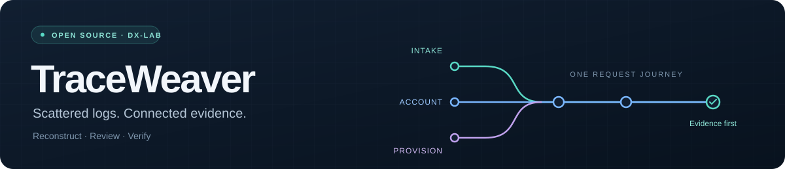

# TraceWeaver Frontend

> Giao diện dành cho người vận hành và người duyệt hồ sơ để tra cứu log, theo dõi hành trình yêu cầu và kiểm chứng kết quả xử lý.



TraceWeaver gom các sự kiện từ nhiều dịch vụ vào một hồ sơ điều tra. Từ một yêu cầu gặp lỗi, bạn có thể xem từng bước đã ghi nhận, kiểm tra bằng chứng liên kết và theo dõi việc xử lý đến khi đóng hồ sơ.

## Tính năng

- Tra cứu sự kiện theo nguồn và thời gian UTC+7; đọc mã yêu cầu, hoạt động, kết quả từng bước và nội dung log.
- Xem kết quả tái dựng dưới dạng dòng thời gian hoặc bảng liên kết; mở bằng chứng và duyệt các liên kết theo quyền được cấp.
- Tạo hồ sơ từ kết quả tái dựng, phân công xử lý, bổ sung bằng chứng và chuyển trạng thái hồ sơ.
- Kiểm chứng nghiệp vụ trong sandbox: xem điều kiện cấp môi trường, chạy lại thao tác, kiểm tra chuyển log và lưu bằng chứng kiểm chứng theo vai trò.
- Xem tổng quan hồ sơ cần xử lý và tìm bài viết trong kho tri thức.
- Chuyển workspace, đăng nhập qua Keycloak và quản trị thành viên, vai trò, quyền đọc nguồn hoặc tạo tài khoản khi có quyền admin.

Kết quả một sự kiện, trạng thái lần phân tích và trạng thái hồ sơ được hiển thị riêng. Một lần phân tích hoàn tất chưa đủ để kết luận yêu cầu nghiệp vụ đã thành công; điều kiện đóng hồ sơ do backend kiểm tra.

## Công nghệ

| Thành phần | Công nghệ sử dụng |
| --- | --- |
| Giao diện | React 19, TypeScript với chế độ strict |
| Định tuyến | React Router 7, lazy loading theo trang |
| Quản lý trạng thái | Context, hooks và controller theo nghiệp vụ |
| Giao diện dùng chung | Tailwind CSS 4, component từ shadcn/ui, Radix UI và icon MUI |
| Gọi API | Axios, schema Zod để kiểm tra dữ liệu |
| Biểu mẫu | React Hook Form, Zod, `zodResolver` |
| Đăng nhập SSO | Keycloak qua public client |
| Công cụ phát triển | Vite 8, Oxlint, Prettier |

Phiên bản dependency được khóa trong `package-lock.json`. Danh sách và giấy phép từng package nằm trong [DEPENDENCIES.md](./DEPENDENCIES.md).

## Cấu trúc thư mục

```text
src/
├── app/                  # Các provider toàn ứng dụng
├── components/
│   ├── layout/           # Header, sidebar và bố cục trang
│   └── ui/               # Component dùng chung
├── config/               # Kiểm tra cấu hình môi trường
├── constants/            # Đường dẫn và tiêu đề trang
├── features/
│   ├── auth/
│   ├── workspace/
│   │   └── admin/
│   ├── events/
│   ├── cases/
│   │   └── sandbox/
│   ├── reconstruction/
│   │   └── review/
│   ├── dashboard/
│   └── knowledge/
├── hooks/                # Hook dùng trên nhiều màn hình
├── pages/                # Ghép các feature thành màn hình
├── routes/               # Router, route guard và trạng thái tải trang
├── services/             # HTTP client, endpoint và xử lý lỗi API
├── styles/               # CSS global và token giao diện
├── types/                # Kiểu dữ liệu dùng chung theo miền
├── utils/                # Hàm tiện ích dùng chung
├── App.tsx
└── main.tsx
```

Component và logic riêng nằm trong feature tương ứng. Thư mục `state/` của feature giữ Context, Provider, reducer và controller gần nhau. Service đặt trực tiếp trong feature; chẳng hạn `createCasesService.ts` tạo service, còn `casesService.ts` cung cấp instance dùng trong ứng dụng.

DTO dùng chung được suy ra từ schema Zod bằng `z.infer` và đặt trong `types/`. Props hoặc state chỉ dùng ở một nơi vẫn nằm cạnh code sử dụng. File trong `public/` được truy cập trực tiếp bằng URL.

## Chạy trên máy

### Yêu cầu

- Node.js 22.12 trở lên và npm. Vite đang dùng cũng hỗ trợ Node.js 20 từ bản 20.19.
- API và Keycloak hoạt động, cùng tài khoản có membership trong workspace cần truy cập.

Nếu cần dựng cả backend và dịch vụ đăng nhập, xem [hướng dẫn cài đặt hệ thống](../INSTALL.md).

### Cài đặt

1. Clone repository và vào thư mục frontend:

   ```bash
   git clone https://github.com/HaUI-Tam-Thai-Tu/TraceWeaver.git
   cd TraceWeaver/frontend
   ```

2. Cài dependency theo lockfile:

   ```bash
   npm ci
   ```

3. Sao chép `.env.example` thành `.env.development.local`, rồi chỉnh cấu hình cho môi trường bạn dùng. Trên PowerShell:

   ```powershell
   Copy-Item .env.example .env.development.local
   ```

4. Khởi động Vite:

   ```bash
   npm run dev
   ```

Mở [http://localhost:5173](http://localhost:5173). Ứng dụng chuyển sang Keycloak để đăng nhập khi chưa có phiên hợp lệ. Cổng 5173 được cố định; Vite sẽ báo lỗi nếu cổng đang bận.

### Biến môi trường

| Biến | Giá trị cần cấu hình |
| --- | --- |
| `VITE_API_BASE_URL` | HTTPS origin của API, không kèm path. Service tự thêm `/api/v1`. |
| `VITE_KEYCLOAK_URL` | HTTPS URL của Keycloak. |
| `VITE_KEYCLOAK_REALM` | Realm chứa tài khoản đăng nhập. |
| `VITE_KEYCLOAK_CLIENT_ID` | Public client dành cho frontend. |

Các biến `VITE_*` được đưa vào bundle trình duyệt. Chỉ dùng giá trị công khai; mật khẩu, client secret và token không được đặt trong các biến này. Giữ file `.env.*.local` ở máy, ngoài Git.

API cần cho phép CORS từ origin frontend, còn Keycloak cần khai báo redirect URI tương ứng. Vite hiện không cấu hình proxy API. Chỉ để trống `VITE_API_BASE_URL` khi môi trường phát triển phục vụ API cùng origin với frontend; bản production yêu cầu HTTPS origin hợp lệ.

## Kiểm tra và build

Chạy trong thư mục `frontend/`:

```bash
npm run lint
node node_modules/typescript/bin/tsc -p tsconfig.app.json --noEmit --strict
node node_modules/typescript/bin/tsc -p tsconfig.node.json --noEmit --strict
```

Để build, sao chép `.env.example` thành `.env.production.local`, chỉnh cấu hình rồi chạy:

```bash
npm run build
npm run preview
```

Vite xuất bản build vào `dist/`. Lệnh `preview` phục vụ kiểm tra bản build tại máy; khi triển khai, máy chủ cần trả `index.html` cho các đường dẫn của SPA để mở được deep link.

VS Code đã có cấu hình dùng extension `esbenp.prettier-vscode` và format khi lưu. Cài extension Prettier nếu máy bạn chưa có; quy tắc định dạng nằm trong `.prettierrc.json`.

Frontend hiện chưa có script test tự động. Khi kiểm tra thay đổi, cần thử thêm luồng đăng nhập, chuyển workspace, mở sự kiện, hồ sơ, sandbox và quản trị bằng tài khoản kiểm thử. Kiểm tra cả quyền truy cập, bàn phím và màn hình nhỏ; lint hoặc build thành công chưa thay thế việc kiểm thử các luồng này trên hệ thống thật.

## Bản demo

- [Mở TraceWeaver](https://traceweaver.quizlearn.tech)
- [Hướng dẫn demo và các vai trò](../docs/guides/demo.md)

Chức năng bạn thấy phụ thuộc membership của workspace đang chọn. Quyền admin quản trị workspace không tự bao gồm quyền reviewer hoặc quyền đọc mọi nguồn. Thao tác trong sandbox chỉ tác động đến nghiệp vụ mô phỏng; bật tài khoản nghiệp vụ không thay đổi tài khoản SSO.

## Đóng góp

Báo lỗi qua [Issues](https://github.com/HaUI-Tam-Thai-Tu/TraceWeaver/issues), kèm các bước tái hiện, kết quả mong đợi và ảnh chụp nếu cần. Che token, thông tin đăng nhập và dữ liệu riêng trước khi gửi.

Khi gửi pull request, mô tả phần đã sửa và các kiểm tra đã chạy. Đọc thêm [hướng dẫn đóng góp](../CONTRIBUTING.md).

## Giấy phép

Mã nguồn dự án sử dụng [Apache License 2.0](../LICENSE). Các thư viện và component bên thứ ba giữ giấy phép riêng; xem [DEPENDENCIES.md](./DEPENDENCIES.md) và [THIRD_PARTY_NOTICES.txt](./THIRD_PARTY_NOTICES.txt).
